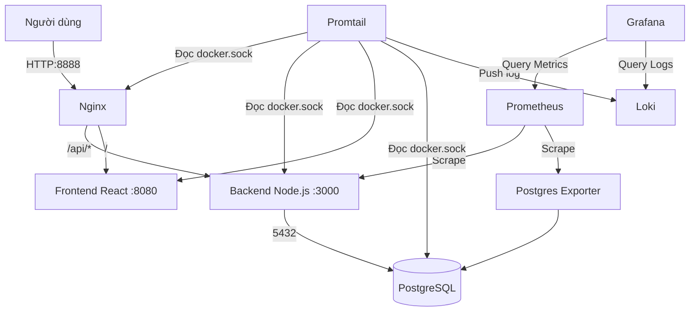

# TÀI LIỆU ÔN TẬP VÀ BẢO VỆ MÔN TRIỂN KHAI & QUẢN TRỊ HỆ THỐNG
**Dự án:** Booking Tour – Kinh Bắc Du Ký

---

## PHẦN 1. TỔNG QUAN VÀ KIẾN TRÚC HỆ THỐNG
- **Mục tiêu:** Xây dựng hệ thống đặt tour du lịch, quản trị tour, khách hàng, hướng dẫn viên.
- **Công nghệ cốt lõi:**
  - **Backend:** Node.js (Express).
  - **Frontend:** React (Vite).
  - **Database:** PostgreSQL 16.
- **Triển khai & Quản trị (DevOps):**
  - Containerization: Docker & Docker Compose.
  - Reverse Proxy / Web Server: Nginx.
  - Giám sát Metrics: Prometheus & Grafana & Postgres-Exporter.
  - Quản trị Logs: Loki & Promtail.

**Các dịch vụ cấu hình trong Docker Compose:**
1. `postgres` (Cổng nội bộ 5432): Lưu trữ dữ liệu.
2. `pgadmin` (Cổng 5050): Quản trị DB qua UI.
3. `postgres-exporter`: Lấy metrics từ PostgreSQL cho Prometheus.
4. `backend` (Cổng 3000): Xử lý API, kết nối DB.
5. `frontend` (Cổng 8080 nội bộ): Render UI.
6. `nginx` (Cổng host 8888): Đứng đầu mạng lưới, hứng request.
7. `prometheus` (Cổng 9090): Lấy metrics.
8. `grafana` (Cổng 3001): Dashboard.
9. `loki` (Cổng 3100): Chứa log.
10. `promtail`: Đọc log từ docker socket.

**Sơ đồ Kiến trúc (Mermaid):**


---

## PHẦN 2 & 3. PHÂN TÍCH BACKEND VÀ FRONTEND
**Backend (BE):**
- Điểm khởi chạy: `backend/src/server.js`. Định nghĩa các route chính (`/api/tours`, `/api/bookings`, `/api/auth`...) và cấu hình module `prom-client` để xuất metrics `/metrics` cho Prometheus.
- **Luồng hoạt động (VD: Đặt tour):** Client -> Nginx -> Route `/api/bookings` -> `bookingController.js` (Validate token, kiểm tra slot) -> Ghi xuống DB PostgreSQL qua file cấu hình `db.js` -> Trả về JSON.

**Frontend (FE):**
- Sử dụng React và Vite (`App.jsx`).
- Các component và trang (Pages) gọi API bằng các hàm fetch. Khi gọi `/api/...`, Nginx ở phía trước sẽ tự động proxy request sang container `backend:3000` (giải quyết triệt để lỗi CORS).

---

## PHẦN 4. DOCKER VÀ DOCKER COMPOSE
- **Docker:** Gói ứng dụng và môi trường vào container để chạy ở bất kỳ đâu không sợ lỗi môi trường.
- **Port Mapping (`8888:8080`):** 8888 là cổng host (người dùng gõ `localhost:8888`), 8080 là cổng mở bên trong container Nginx.
- **Volumes:** 
  - `postgres_data:/var/lib/postgresql/data`: Giúp dữ liệu DB không bị mất (persistent) khi chạy `docker compose down`.
  - `/var/run/docker.sock:/var/run/docker.sock`: Cho phép Promtail đọc được log của tất cả các container khác.
- **Healthcheck:** 
  - Backend gọi `wget http://localhost:3000/api/tours` để kiểm tra có sống không.
  - Nginx gọi `wget http://localhost:8080/`.
- **Lệnh thường dùng:**
  - `docker compose up -d --build`: Build lại image (áp dụng code mới) và chạy ngầm (detached).
  - `docker compose logs -f backend`: Theo dõi log trực tiếp của backend.

---

## PHẦN 5. NGINX, REVERSE PROXY VÀ HTTPS
- **Reverse Proxy:** Là người trung gian. Che giấu kiến trúc bên trong. Trong `nginx.conf`:
  ```nginx
  location /api/ { proxy_pass http://backend:3000; }
  location / { proxy_pass http://frontend:8080; }
  ```
- **Bảo mật (Security Headers):** Có dùng `X-Frame-Options`, `X-XSS-Protection`, `CSP`. (Chống Clickjacking, XSS).
- **HTTPS:** Hiện tại dự án **chưa cấu hình HTTPS** (chỉ chạy HTTP cổng 8888). *Nếu thầy hỏi, hãy trung thực trả lời là đang triển khai nội bộ/local nên chưa xin cấp chứng chỉ SSL (Let's Encrypt).*

---

## PHẦN 6 & 7. PROMETHEUS, GRAFANA, LOKI VÀ PROMTAIL
- **Prometheus:** Pull metrics 15s một lần (Khai báo trong `prometheus.yml` với các target `backend:3000` và `postgres-exporter:9187`).
- **Loki & Promtail:** 
  - Khác với Metrics (là con số), Log là chuỗi văn bản báo cáo sự kiện (Ví dụ: "User A logged in").
  - Promtail thu thập log, Loki lưu trữ.
- **Grafana:** Giao diện trực quan hóa cả Metrics (bằng PromQL) và Logs (bằng LogQL).
- **Câu lệnh LogQL mẫu (Thầy hay yêu cầu gõ live):**
  - `{container_name="booking-backend"}` (Lấy toàn bộ log backend).
  - `{container_name="booking-backend"} |= "error"` (Lọc những dòng log chứa chữ error).

---

## PHẦN 8. BẢO MẬT & DATABASE
- **Biến môi trường (.env):** Giấu password DB (`POSTGRES_PASSWORD`). Không được commit file `.env` lên Github (đã cấu hình trong `.gitignore`).
- **Network Isolation:** Phân chia thành `frontend-net`, `backend-net`, `db-net`. Frontend KHÔNG THỂ ping trực tiếp đến PostgreSQL (chỉ Backend mới thuộc `db-net`). Điều này chống tấn công trực diện vào DB.
- **Non-root container:** Nginx dùng image `nginx-unprivileged:alpine`. Kẻ tấn công nếu chiếm được Nginx cũng không có quyền root.

---

## PHẦN 11. 60 CÂU HỎI VẤN ĐÁP (TRÍCH DẪN CÁC CÂU QUAN TRỌNG NHẤT)

**Câu 1: Dự án của em dùng những công nghệ gì cho việc triển khai?**
*Trả lời:* Em dùng Docker Compose để orchestrate các container. Nginx làm Reverse Proxy. Prometheus + Postgres-Exporter thu thập Metrics. Loki + Promtail quản lý Log. Grafana làm Dashboard trực quan.

**Câu 2: Tại sao trong docker-compose em lại phân ra nhiều network (frontend-net, backend-net, db-net)?**
*Trả lời:* Để tăng tính bảo mật (Network Isolation). Container Frontend chỉ giao tiếp được với Nginx và Backend, không thể nhìn thấy Database. Chỉ có Backend mới được cấp mạng `db-net` để kết nối Database.

**Câu 3: Em làm sao để dữ liệu Database không bị mất khi xóa container?**
*Trả lời:* Em sử dụng Docker Volume có tên `postgres_data` ánh xạ vào đường dẫn `/var/lib/postgresql/data` bên trong container. Dù container bị xóa, volume trên máy host vẫn giữ nguyên dữ liệu.

**Câu 4: Nginx trong dự án có vai trò gì? Khối cấu hình nào chứng minh điều đó?**
*Trả lời:* Nginx đóng vai trò Reverse Proxy. Khối `location /api/ { proxy_pass http://backend:3000; }` sẽ bắt mọi request có chữ `/api/` và chuyển ngầm vào backend, tránh lỗi CORS cho frontend.

**Câu 5: Depends_on có ý nghĩa gì? Có chắc chắn backend kết nối được DB không?**
*Trả lời:* `depends_on` định nghĩa thứ tự khởi động. Tuy nhiên, em dùng thêm `condition: service_healthy` dựa trên healthcheck `pg_isready` của postgres. Nhờ vậy Docker sẽ chờ DB thực sự sẵn sàng nhận kết nối rồi mới bật Backend.

**Câu 6: Em truy vấn log lỗi của backend trong Grafana như thế nào?**
*Trả lời:* Em vào Grafana Explore, chọn Data source là Loki, dùng câu lệnh LogQL: `{container_name="booking-backend"} |= "error"` hoặc `|~ "(?i)error"`.

**Câu 7: Cổng 8888 trên Nginx khác gì cổng 8080?**
*Trả lời:* 8888 là Host Port (người dùng bên ngoài internet gõ localhost:8888). 8080 là Container Port (cổng mà phần mềm Nginx bên trong đang lắng nghe). Docker thực hiện ánh xạ (Port mapping) 8888 -> 8080.

**Câu 8: Hệ thống của em đã có HTTPS chưa? Nếu chưa thì rủi ro là gì?**
*Trả lời:* Hiện tại dự án chạy local nên em dùng HTTP. Rủi cấu hình HTTPS (chứng chỉ SSL/TLS), chỉ dùng HTTP. Đây là điểm cần lưu ý khi thầy hỏi.

**Câu 9: Promtail lấy log từ các container bằng cơ chế nào?**
*Trả lời:* Em mount volume `/var/run/docker.sock` từ máy host vào Promtail. Promtail đọc trực tiếp luồng stream từ Docker Engine nên lấy được log của toàn bộ hệ thống.

**Câu 10: Giả sử Nginx báo 502 Bad Gateway, em sẽ kiểm tra theo quy trình nào?**
*Trả lời:* 
1. 502 nghĩa là Nginx không liên lạc được với backend/frontend.
2. Em dùng lệnh `docker compose ps` xem backend có đang bị restart hoặc exited không.
3. Dùng `docker compose logs backend` để xem app Node.js bị lỗi gì (ví dụ sập do thiếu biến môi trường hoặc sai pass DB).

---
## LƯU Ý KHI BẢO VỆ
- **Chuẩn bị sẵn Terminal:** Biết cách gõ `docker compose ps`, `docker compose logs -f backend`.
- **Mở sẵn Grafana (localhost:3001):** Biết chỗ chuyển đổi giữa Prometheus (Metrics) và Loki (Logs).
- **Mở file Nginx / Compose:** Nhớ vị trí dòng lệnh cấu hình (ví dụ dòng cấu hình healthcheck, dòng định nghĩa volume). Trả lời phải chỉ ra đúng dòng code.
- **Thành thật:** Cấu hình nào có thì nhận, chưa có (như HTTPS) thì trình bày hiểu biết về lý thuyết và hướng khắc phục.
