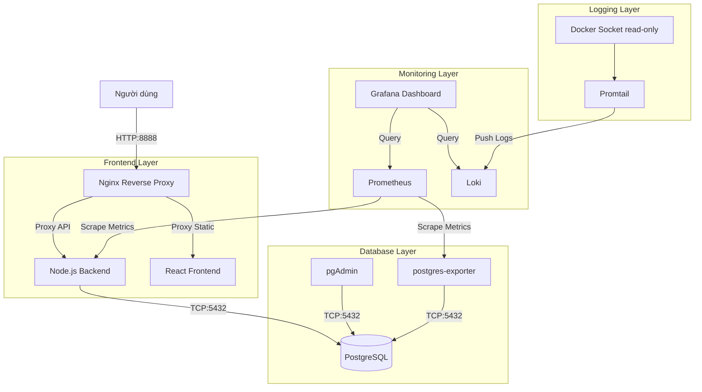

# 1. Tên đề tài

**HỆ THỐNG BOOKING TOUR / DU LỊCH**

## 2. Thông tin sinh viên

* Họ và tên: `Dương Văn Vương`
* Mã sinh viên: `DTC245200671`
* Lớp: `CNTTK23M`
* Môn học: Triển khai và Quản trị Hệ thống Phần mềm
* Đề tài: Đề 20 – Hệ thống Booking Tour / Du lịch

## 3. Giới thiệu hệ thống

Hệ thống đặt tour du lịch cho phép khách hàng xem danh sách các tour, xem chi tiết và thực hiện đặt tour (booking).
- **Người dùng:** Tìm kiếm tour, xem chi tiết lịch trình, hình ảnh và tiến hành đặt tour.
- **Admin:** Quản lý danh sách tour, lịch trình, khách hàng, hướng dẫn viên, khuyến mãi và các đơn booking.
- **Backend:** Cung cấp API (RESTful) xử lý logic nghiệp vụ, quản lý file upload và xác thực.
- **Database:** Lưu trữ toàn bộ dữ liệu của hệ thống, được khởi tạo tự động qua script.
- **Docker Compose:** Được sử dụng để đóng gói toàn bộ ứng dụng thành các container độc lập, giúp việc triển khai (deploy) trở nên dễ dàng, nhất quán trên mọi môi trường và hỗ trợ quản lý network/volume hiệu quả.

## 4. Kiến trúc hệ thống



## 5. Công nghệ sử dụng

| Thành phần | Công nghệ | Vai trò |
| ---------- | --------- | ------- |
| **Frontend** | React, Vite | Xây dựng giao diện người dùng |
| **Backend** | Node.js, Express | Xử lý logic API, Authentication |
| **Database** | PostgreSQL | Hệ quản trị cơ sở dữ liệu quan hệ |
| **DB Admin** | pgAdmin4 | Giao diện web quản lý cơ sở dữ liệu |
| **Proxy** | Nginx | Reverse Proxy, phục vụ frontend & chặn API |
| **Monitoring** | Prometheus, Grafana | Thu thập Metrics, tạo Dashboard giám sát |
| **Logging** | Loki, Promtail | Thu thập và truy vấn Log tập trung qua Docker Socket |
| **Deploy** | Docker, Docker Compose | Đóng gói và điều phối các dịch vụ |

## 6. Cấu trúc thư mục

```text
booking-tour/
├── backend/            # Source code Node.js/Express, Dockerfile backend
├── frontend/           # Source code React/Vite, cấu hình Nginx SPA, Dockerfile frontend
├── database/           # Chứa file init.sql để khởi tạo table/data lúc build db
├── nginx/              # Cấu hình Nginx Reverse Proxy (Gateway) và Security Headers
├── prometheus/         # Cấu hình prometheus.yml để scrape metrics
├── grafana/            # Provisioning datasource + dashboard (tự nạp khi container khởi động)
│   ├── provisioning/   #   datasources.yml (Prometheus + Loki), dashboards.yml
│   └── dashboards/     #   booking-tour-overview.json (dashboard tổng quan)
├── loki/               # Cấu hình loki-config.yml
├── promtail/           # Cấu hình promtail-config.yml kết nối docker.sock
├── docker-compose.yml  # File orchestration cấu hình toàn bộ 10 services
└── README.md           # Tài liệu hướng dẫn
```

## 7. Yêu cầu môi trường

* Docker: version 20.10.x trở lên
* Docker Compose: version 2.x trở lên
* Git: Để clone repository
* (Optional) Node.js: Môi trường dev local nếu cần

## 8. Cài đặt và chạy hệ thống

**Bước 1: Clone dự án**
```bash
git clone https://github.com/DuongVuong05/DTC245200671-booking-tour.git
cd booking-tour
```

**Bước 2: Chuẩn bị biến môi trường**
```bash
cp .env.example .env
# Mở .env và điền giá trị thật (JWT_SECRET, mật khẩu DB, SMTP Gmail...)
```
Nếu không tạo `.env`, hệ thống vẫn chạy được với giá trị mặc định trong docker-compose.yml (chỉ nên dùng cho demo — đổi mật khẩu nếu triển khai thật).

**Bước 3: Khởi chạy hệ thống**
```bash
docker compose up -d --build
```

**Bước 4: Kiểm tra trạng thái**
```bash
docker compose ps
```

**Bước 5: Xem log nếu có lỗi**
```bash
docker compose logs backend
```

*(Database sẽ tự động chạy script `database/init.sql` trong lần build đầu tiên — gồm bảng tours, customers, bookings, tour_schedules, users, vehicles, promotions, explore_items, guides + dữ liệu demo.)*

## 9. Environment Variables

Trong hệ thống có sử dụng các biến cấu hình (đặt trong `.env`, mẫu ở `.env.example`):
- `POSTGRES_PASSWORD`: Mật khẩu database PostgreSQL — **bắt buộc**, dùng chung cho postgres + backend + postgres-exporter (không chứa dấu nháy đơn `'`).
- `PGADMIN_PASSWORD`: Mật khẩu đăng nhập pgAdmin — **bắt buộc**.
- `JWT_SECRET`: Chuỗi bảo mật để ký JSON Web Token (bắt buộc — backend sẽ thoát nếu thiếu).
- `SMTP_HOST/PORT/USER/PASS`: Gmail dùng gửi email xác nhận đặt tour và mã OTP.
- `CORS_ORIGINS`: Danh sách các domain được phép truy cập API.
- `DB_HOST/PORT/NAME/USER/PASSWORD`: chỉ dùng khi chạy backend trực tiếp trên host (không qua Docker).

### Dữ liệu demo (seed — idempotent, chạy lại được)

```bash
docker compose exec backend npm run seed             # tài khoản admin mặc định (admin/admin123)
docker compose exec backend npm run seed:tours       # 6 tour nổi bật + lịch khởi hành tương lai
docker compose exec backend npm run seed:promotions  # 5 mã giảm giá
docker compose exec backend npm run seed:vehicles    # 5 phương tiện
docker compose exec backend npm run seed:guides      # 5 hướng dẫn viên
```

**CẢNH BÁO:** Tuyệt đối không commit file `.env` chứa mật khẩu thật lên GitHub. Chỉ đưa file `.env.example` với các giá trị mẫu.

## 10. Danh sách Docker Services

| Service | Container | Port Host | Chức năng |
| ------- | --------- | --------- | --------- |
| **postgres** | booking-postgres | 5433 | Lưu trữ dữ liệu hệ thống (PostgreSQL) |
| **pgadmin** | booking-pgadmin | 5050 | Web UI quản lý DB PostgreSQL |
| **postgres-exporter** | booking-postgres-exporter | 9187 | Agent thu thập DB metrics cho Prometheus |
| **backend** | booking-backend | 3000 | API Server Node.js |
| **frontend** | booking-frontend | 8082 | Ứng dụng Web Client React |
| **nginx** | booking-nginx | 8888 | Reverse Proxy Gateway chung |
| **prometheus**| booking-prometheus| 9090 | Thu thập metrics từ các container |
| **grafana** | booking-grafana | 3001 | Dashboard hiển thị Monitor & Log |
| **loki** | booking-loki | 3100 | Nơi lưu trữ Log tập trung |
| **promtail** | booking-promtail | (None) | Agent đọc docker.sock đẩy log lên Loki |

Tất cả service đều có `restart: unless-stopped`.

## 11. Website Booking Tour

- **Website khách hàng (qua Nginx Proxy):** `http://localhost:8888`
- **Frontend trực tiếp:** `http://localhost:8082`
- **Admin:** `http://localhost:8888/admin/login`

Các chức năng đã triển khai:
- Trang chủ hiển thị Tour nổi bật + mục "Khám phá Bắc Ninh" (dữ liệu từ DB — quản lý tại Admin → Khám phá Bắc Ninh).
- Danh sách Tour (tìm kiếm, lọc, sắp xếp, phân trang) và chi tiết Tour (lịch khởi hành, bao gồm/không bao gồm, chính sách, gallery).
- Đặt tour: đăng nhập khách hàng → chọn lịch trình → số khách → nhập thông tin → mã giảm giá → xác nhận. Booking ghi thật vào PostgreSQL (transaction chống overbooking, chặn đặt lịch đã khởi hành, chặn quá số ghế).
- Tra cứu đơn công khai theo Mã đơn + SĐT (`/tra-cuu`); khách xem/hủy đơn của mình tại `/profile`.
- Trang `/hotels` đang là **Coming Soon** (chưa triển khai đặt phòng thật — không có booking giả).

### Tài khoản demo

- **Admin:** chạy `docker compose exec backend node seed.js` để tạo tài khoản `admin` / `admin123` (đổi mật khẩu ngay sau demo). Hoặc dùng tài khoản admin đã tạo trên DB hiện tại của bạn.
- **Khách hàng:** đăng ký trực tiếp tại `http://localhost:8888/register`.

## 12. PostgreSQL + pgAdmin

- **PostgreSQL:** Lưu trữ các bảng `users`, `tours`, `bookings`, `customers`, `tour_schedules`, `vehicles`, `promotions`, `explore_items`, `guides`...
- **Database name:** `booking_tour`
- **User:** `booking_admin`
- **Port:** Mở port `5433` ra máy host (port nội bộ là 5432).
- **pgAdmin:** Truy cập tại `http://localhost:5050` (Email: `admin@gmail.com` / Pass: `PgAdmin@2026#Secure` nếu dùng giá trị mặc định).

*Cách kết nối trong pgAdmin:* Tạo Server mới, Host là `postgres` (gọi theo tên service Docker network), port `5432`, Username/Password như trên.

## 13. Nginx Reverse Proxy – COMMIT 1

**Chức năng:** Nginx đứng làm Gateway duy nhất hứng request ở cổng `8888`.
- Luồng request `/api/*`: Sẽ được proxy_pass về `http://backend:3000`.
- Luồng request `/`: Trả về giao diện tĩnh của Frontend.
- Nginx được cấu hình sẵn các Security Headers: `X-Frame-Options`, `X-XSS-Protection`, `X-Content-Type-Options`, `Referrer-Policy`, `Content-Security-Policy` để phòng chống XSS, Clickjacking.
- Lưu ý: hệ thống demo chạy **HTTP** (không cấu hình HTTPS/self-signed).

**Commit 1 – Nginx Reverse Proxy + Security Headers**

## 14. Prometheus + Grafana – COMMIT 2

- **Prometheus (Cổng 9090):** Thu thập metrics. Được cấu hình để theo dõi:
  - Backend (thư viện prom-client ở route `/metrics` — `http_requests_total`, CPU, event loop lag...)
  - PostgreSQL (thông qua `postgres-exporter` cổng 9187 — `pg_up`, số kết nối, dung lượng DB, transactions, INSERT/s)
- **Grafana (Cổng 3001 - admin/admin):** tự động nạp Datasource **Prometheus** (default) + **Loki** và dashboard **"Booking Tour — Tổng quan hệ thống"** qua provisioning (`grafana/provisioning/`) — không cần cấu hình tay sau khi `docker compose up`.

Hướng dẫn kiểm tra:
1. Vào `http://localhost:9090/targets`, kiểm tra 3 target đang ở trạng thái UP: `prometheus`, `booking-backend`, `postgres`.
2. Vào `http://localhost:3001` → Dashboards → "Booking Tour — Tổng quan hệ thống".

**Commit 2 – Monitoring**

## 15. Loki + Promtail + LogQL – COMMIT 3

- **Promtail:** Được mount với `/var/run/docker.sock` (read-only) trên máy host để tự động đọc log từ các container đang chạy.
- **Loki:** Nhận log từ Promtail và lưu trữ.
- **Grafana:** Truy cập Explore, chọn Datasource Loki để truy vấn.

**Các LogQL mẫu sử dụng label thực tế (container_name):**

1. Lấy toàn bộ log của Nginx Reverse Proxy:
```logql
{container_name="booking-nginx"}
```

2. Lấy toàn bộ log của Backend API:
```logql
{container_name="booking-backend"}
```

3. Tìm kiếm lỗi (chứa chữ "error") trong backend:
```logql
{container_name="booking-backend"} |= "error"
```

**Commit 3 – Centralized Logging**

## 16. Hardening

Hệ thống đã triển khai các biện pháp bảo mật sau:

| Biện pháp | Cách triển khai | File liên quan |
| --------- | --------------- | -------------- |
| **Non-root container** | Sử dụng image `nginxinc/nginx-unprivileged` cho frontend/proxy và khai báo `USER node` cho Backend. | `backend/Dockerfile`, `frontend/Dockerfile`, `docker-compose.yml` |
| **Network isolation** | Phân tách thành 4 mạng: `db-net`, `backend-net`, `frontend-net`, `monitor-net`. Container nào cần mới được giao tiếp với nhau. | `docker-compose.yml` |
| **Mật khẩu** | Bắt buộc cung cấp qua `.env` (compose báo lỗi nếu thiếu — không dùng mật khẩu mặc định hardcode). | `docker-compose.yml`, `.env`, `.env.example` |
| **Security Headers** | Áp dụng Content-Security-Policy, X-XSS-Protection... cho proxy. | `nginx/nginx.conf` |
| **Docker Socket** | Chỉ Promtail được quyền đọc docker.sock (mount `:ro`) để thu thập log, không public; promtail chỉ thu log container `booking-*`. | `docker-compose.yml`, `promtail/promtail-config.yml` |
| **Xác thực API** | JWT httpOnly cookie (typ admin/customer riêng), OTP xác thực email nhân viên, rate-limit đăng nhập/booking/tra cứu. Mọi API sửa/xóa (tour, lịch trình, khách hàng, explore, guides...) đều yêu cầu token Admin/Staff. | `backend/src/middleware/`, `backend/src/routes/` |

## 17. Docker Network

Hệ thống cô lập qua 4 mạng:
- `frontend-net`: Giành cho Client giao tiếp với Nginx, Frontend.
- `backend-net`: Giành cho Nginx giao tiếp với Backend, Frontend gọi Backend.
- `db-net`: Nơi **duy nhất** Backend có thể gọi tới PostgreSQL. Các dịch vụ frontend/nginx bị cấm truy cập mạng này.
- `monitor-net`: Chứa hệ sinh thái Grafana, Prometheus, Loki, Promtail.

## 18. Docker Volumes

| Volume | Mục đích |
| ------ | -------- |
| `postgres_data` | Persist dữ liệu của PostgreSQL, không mất data khi down container. |
| `uploads_data` | Persist hình ảnh/file khách hàng upload qua backend API. |

*Các file cấu hình (`nginx.conf`, `prometheus.yml`, `init.sql`, `grafana/provisioning`) được mount dạng bind-mount `Read-Only` (`:ro`) để bảo mật.*

## 19. Healthcheck & Restart

- PostgreSQL được cấu hình Healthcheck thông qua lệnh `pg_isready`; Backend có `depends_on: postgres: condition: service_healthy`, đảm bảo DB khởi động xong Backend mới start.
- Tất cả service đều có `restart: unless-stopped` — container tự khởi động lại khi tắt/bật Docker.

## 20. Kiểm tra hệ thống

- Website hoạt động (localhost:8888)
- PostgreSQL hoạt động (Port 5433 host)
- pgAdmin kết nối PostgreSQL thành công (localhost:5050)
- Nginx Reverse Proxy hoạt động chặn API/Static (Security Headers đầy đủ)
- Prometheus nhận metrics (localhost:9090/targets — 3 target UP)
- Grafana hiển thị dashboard provisioning (localhost:3001)
- PostgreSQL monitoring hoạt động (postgres-exporter — pg_up = 1)
- Loki hoạt động
- Promtail hoạt động (Đọc docker.sock read-only)
- LogQL truy vấn được (Test qua Grafana Explore)
- Hardening đã được kiểm tra (Non-root, mạng cô lập, docker.sock :ro)

## 21. API chính

| API | Method | Mục đích | Quyền |
| --- | ------ | -------- | ----- |
| /api/tours | GET | Danh sách tour (có ?featured=true) | Public |
| /api/tours/:id | GET | Chi tiết tour + lịch trình | Public |
| /api/tours | POST/PUT/DELETE | CRUD tour | Admin/Staff |
| /api/schedules, /api/schedules/tour/:tourId | GET | Lịch trình | Public |
| /api/schedules | POST/PUT/DELETE | CRUD lịch trình | Admin/Staff |
| /api/bookings | POST | Đặt tour (transaction chống overbooking) | Customer (đã đăng nhập) |
| /api/bookings | GET | Danh sách booking | Admin/Staff/Ketoan |
| /api/bookings/stats | GET | Thống kê tổng quan | Admin/Staff/Ketoan |
| /api/bookings/:id/status | PUT | Cập nhật trạng thái (hoàn ghế khi hủy) | Admin/Staff |
| /api/bookings/my-bookings | GET | Đơn của khách hàng | Customer |
| /api/bookings/lookup | GET | Tra cứu đơn công khai (mã + SĐT) | Public (rate-limited) |
| /api/bookings/:id/cancel | POST | Khách hủy đơn Pending | Customer |
| /api/customers | GET | Danh sách khách hàng | Admin/Staff |
| /api/customers/me | PUT | Khách sửa hồ sơ | Customer |
| /api/auth/login, /logout, /me, /verify-otp | POST/GET | Xác thực nhân viên | Public |
| /api/auth/customer/login, /register, /logout | POST | Xác thực khách hàng | Public |
| /api/auth/users | GET/POST/PUT/DELETE | Quản lý tài khoản nhân viên | Admin |
| /api/vehicles, /api/promotions | CRUD | Phương tiện, khuyến mãi | Admin/Staff |
| /api/promotions/apply | POST | Áp mã giảm giá | Public (rate-limited) |
| /api/explore | GET | Mục khám phá trang chủ | Public |
| /api/explore | POST/PUT/DELETE | Quản lý mục khám phá | Admin/Staff |
| /api/guides | CRUD | Quản lý hướng dẫn viên | GET public, POST/PUT/DELETE Admin |
| /api/upload | POST | Upload ảnh (whitelist mimetype, 5MB) | Admin/Staff |
| /metrics | GET | Metrics Prometheus (prom-client) | Public |

## 22. Troubleshooting

- **Container backend không start / Exited(255) vì port 3000 bị chiếm:** một process Node chạy trực tiếp trên host đang giữ port 3000. Tắt process đó (hoặc đổi mapping port trong docker-compose.yml) rồi chạy lại `docker compose up -d backend`.
- **Container postgres liên tục restart:** Cổng 5433 trên máy host bị chiếm, hoặc file init.sql lỗi. Xem log: `docker compose logs postgres`
- **Nginx báo 502 Bad Gateway:** Backend chưa chạy lên kịp. Chờ 5 giây và tải lại, hoặc kiểm tra `docker compose logs backend`.
- **Grafana không thấy dashboard:** kiểm tra volume provisioning đã được mount (`docker compose config`), hoặc vào Dashboards → folder "Booking Tour".
- **Prometheus target postgres down:** kiểm tra mật khẩu trong `DATA_SOURCE_NAME` đã được URL-encode (`@` → `%40`, `#` → `%23`) — xem `docker compose logs postgres-exporter`.
- **Loki không có log trong Grafana Explore:** Do chưa chọn đúng Datasource trong Grafana. Vào Connections > Data Sources, chọn Loki (đã provisioning sẵn) → Explore.
- **pgAdmin báo lỗi "Unable to connect to server":** Điền sai Host name, phải điền là `postgres` chứ không phải `localhost`.

## 23. Demo

Thứ tự Demo cho giáo viên:
1. Mở Website `http://localhost:8888` để xem giao diện đặt tour.
2. Chọn một tour thật → đặt tour (đăng nhập/đăng ký khách hàng) → nhận mã booking.
3. Mở pgAdmin `http://localhost:5050` chứng minh Database có record booking vừa tạo (bảng `bookings`, `tour_schedules` đã trừ ghế).
4. Mở Admin `http://localhost:8888/admin/login` → Dashboard (số liệu + biểu đồ lấy từ DB) → Quản lý booking → thấy booking vừa tạo → cập nhật trạng thái.
5. Mở Network (F12) trên trình duyệt, chứng minh Nginx trả về `Security Headers`.
6. Mở Prometheus `http://localhost:9090/targets` chứng minh 3 target UP.
7. Mở Grafana `http://localhost:3001` → Dashboard "Booking Tour — Tổng quan hệ thống" chứng minh metrics thật.
8. Vào Explore, chọn Loki, chạy LogQL `{container_name="booking-nginx"}` chứng minh Log tập trung hoạt động.
9. Trình bày file `docker-compose.yml` để chỉ ra Hardening (non-root, network isolation, docker.sock :ro, restart policy).

## 24. Kết quả

Hệ thống đã triển khai thành công mô hình vi dịch vụ cơ bản bằng Docker Compose. Đáp ứng được việc Routing qua Nginx Proxy, lưu trữ Database an toàn có Healthcheck, thu thập Metrics qua Prometheus và quản lý Log qua bộ đôi Promtail/Loki. Các tiêu chí về bảo mật (Hardening) cũng được đảm bảo ở mức Container.

## TODO / Hạn chế đã biết

- Chưa cấu hình HTTPS/self-signed cho Nginx (demo chạy HTTP).
- Chưa có node-exporter/cadvisor cho metrics CPU/RAM của container/host.
- Ảnh/video tĩnh đang để trong `frontend/public` (chưa nén — vd.mp4 ~59MB).
- Thanh toán online (VNPay/MoMo) chưa triển khai — booking mặc định trạng thái Pending, nhân viên xác nhận thủ công.
- Gmail App Password (SMTP) trong `.env` máy cá nhân đã từng được build vào image cũ — nên xoay (revoke) và cấp lại App Password mới.
