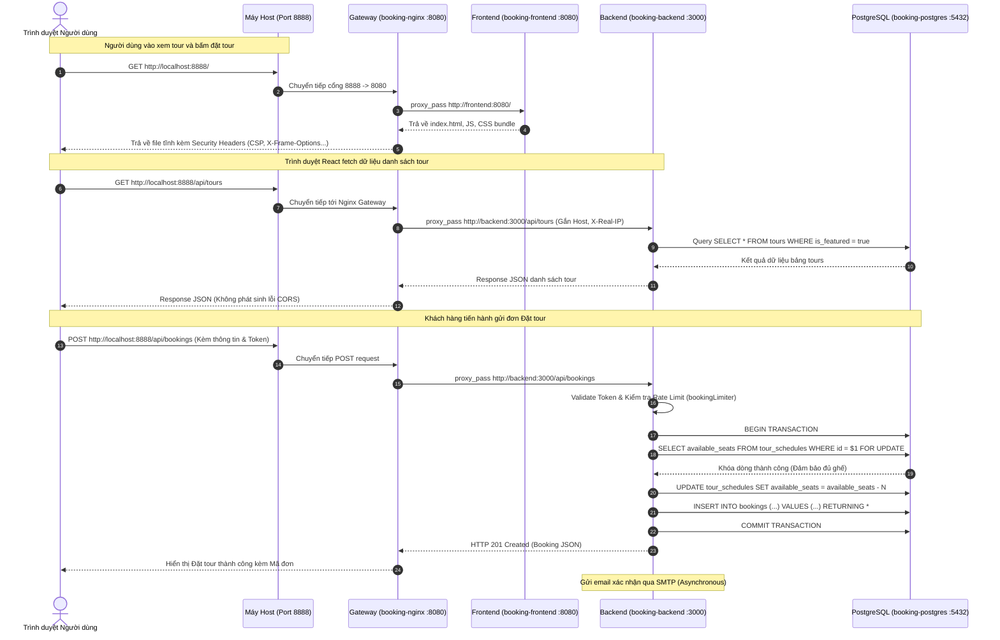
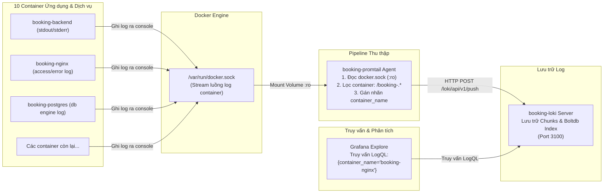

# 01. TỔNG QUAN HỆ THỐNG VÀ KIẾN TRÚC TỔNG THỂ

---

## 1. THÔNG TIN ĐỀ TÀI VÀ MỤC TIÊU HỆ THỐNG

### 1.1. Thông tin chung
- **Đề tài số 20:** Hệ thống Booking Tour / Du lịch (Thương hiệu thực tế trong mã nguồn: *Vuo Travel – Du lịch Kinh Bắc*).
- **Sinh viên thực hiện:** Dương Văn Vương – MSV: `DTC245200671` – Lớp: `CNTTK23M`.
- **Môn học:** Triển khai và Quản trị Hệ thống Phần mềm.
- **Repository GitHub:** `https://github.com/DuongVuong05/DTC245200671-booking-tour.git`
- **Nhánh triển khai chính:** `main`

### 1.2. Mục tiêu hệ thống
1. **Mục tiêu nghiệp vụ:** Cung cấp nền tảng web phục vụ khách hàng tìm kiếm, đặt tour du lịch văn hóa - tâm linh - sinh thái (đặc trưng vùng Kinh Bắc: Chùa Dâu, Làng Diềm, Tây Yên Tử, Tranh Đông Hồ, Chùa Bút Tháp, Đền Đô, Đồng Cao). Cung cấp cổng quản trị (Admin Dashboard) cho nhân viên quản lý tour, lịch trình khởi hành, phương tiện, hướng dẫn viên, khuyến mãi, khách hàng và xử lý đơn đặt tour.
2. **Mục tiêu kỹ thuật (DevOps & Quản trị hệ thống):**
   - Đóng gói toàn bộ các dịch vụ bằng **Docker** và điều phối tập trung qua **Docker Compose**.
   - Thiết lập cổng vào duy nhất (Single Entry Point) sử dụng **Nginx Reverse Proxy**, loại bỏ hoàn toàn việc mở cổng phân tán và triệt tiêu lỗi CORS cho Frontend.j
   - Quản trị dữ liệu quan hệ bền vững bằng **PostgreSQL 16**, kết nối qua cơ chế Docker Network nội bộ và quản trị trực quan qua **pgAdmin4**.
   - Giám sát toàn diện hệ thống: thu thập metrics với **Prometheus** + **Postgres-Exporter** + thư viện `prom-client` của ứng dụng Node.js, trực quan hóa trên **Grafana Dashboard**.
   - Quản trị log tập trung: thu thập stream log container từ Docker Socket bằng **Promtail**, chuyển về kho lưu trữ log **Loki**, hỗ trợ truy vấn nhanh qua ngôn ngữ **LogQL** trên Grafana Explore.
   - Tối ưu bảo mật (Hardening): cô lập mạng 4 tầng (Network Isolation), chạy container với người dùng không đặc quyền (Non-root user), cấu hình các tiêu đề bảo mật HTTP (Security Headers), và kiểm soát quyền truy cập tài nguyên.

---

## 2. PHẠM VI HỆ THỐNG VÀ CÁC CHỨC NĂNG NGHIỆP VỤ THỰC TẾ

*(Toàn bộ các chức năng dưới đây đã được xác minh trực tiếp từ mã nguồn `frontend/src/pages/` và `backend/src/controllers/`)*

### 2.1. Phân hệ Khách hàng (Client Portal)
1. **Trang chủ (`/`):**
   - Hiển thị Banner, video khám phá văn hóa Quan họ (`/qhh.mp4`).
   - Danh sách 6 Tour nổi bật (`is_featured = TRUE`) lấy từ cơ sở dữ liệu.
   - Khám phá các chuyên mục văn hóa, lịch sử, làng nghề, khoa bảng, thiên nhiên, ẩm thực từ bảng `explore_items`.
2. **Danh mục & Chi tiết Tour (`/tours`, `/tours/:id`):**
   - Tìm kiếm theo từ khóa, lọc theo điểm đến, phân loại khoảng giá, sắp xếp theo giá/đánh giá.
   - Xem chi tiết tour: chính sách tour, dịch vụ bao gồm (`included`), không bao gồm (`excluded`), lịch trình khởi hành tương lai (`tour_schedules`), số chỗ còn trống (`available_seats`), thông tin hướng dẫn viên (`guides`).
3. **Quy trình Đặt tour (`/booking/:id`):**
   - Bắt buộc đăng nhập tài khoản khách hàng (`CustomerAuth`) để tránh spam/giữ chỗ ảo.
   - Chọn lịch khởi hành còn khả dụng (hệ thống tự động chặn các lịch trình có ngày đi trong quá khứ).
   - Nhập số lượng khách; áp dụng mã giảm giá (`promotions`) với kiểm tra điều kiện giá trị đơn tối thiểu và hạn sử dụng.
   - Ghi nhận đơn đặt với cơ chế **Database Transaction (BEGIN ... COMMIT)** và khóa dòng (`FOR UPDATE`) để chống bán quá số chỗ (Overbooking).
   - Tự động trừ số chỗ khả dụng trong bảng `tour_schedules`.
   - Gửi email xác nhận đặt tour qua SMTP Nodemailer (không đồng bộ, không làm nghẽn luồng xử lý API).
4. **Tra cứu & Quản lý đơn cá nhân:**
   - Tra cứu công khai (`/tra-cuu`): Khách hàng chỉ cần nhập Mã đơn (dạng `KB-xxx`) và Số điện thoại đặt tour (có áp dụng Rate Limiter chống quét dữ liệu, dữ liệu nhạy cảm được che một phần dạng `Nguyễn***`, `091****78`).
   - Quản lý đơn cá nhân (`/profile`): Xem toàn bộ lịch sử đặt tour, trạng thái đơn; khách hàng được phép tự hủy đơn nếu đơn đang ở trạng thái `Pending` (hệ thống sẽ tự động hoàn lại số chỗ đã giữ).

### 2.2. Phân hệ Quản trị viên (Admin Portal - `/admin/login`)
1. **Bảng điều khiển (Dashboard - `/admin/dashboard`):** Thống kê tổng quan doanh thu thực tế, số lượng tour, số đơn booking, số khách hàng, biểu đồ doanh thu theo tháng và biểu đồ phân bổ trạng thái đơn.
2. **Quản lý Tour (`/admin/tours`):** Thêm, sửa, xóa thông tin tour, upload hình ảnh lên volume tĩnh.
3. **Quản lý Lịch trình (`/admin/schedules`):** Tạo các đợt khởi hành theo ngày đi, ngày về, phân công phương tiện (`vehicles`) và hướng dẫn viên (`guides`), quản lý số lượng chỗ ngồi.
4. **Quản lý Đơn đặt tour (`/admin/bookings`):** Xem danh sách đơn, lọc theo trạng thái (`Pending`, `Confirmed`, `Cancelled`, `Completed`), cập nhật trạng thái đơn (khi chuyển sang `Cancelled` sẽ tự động hoàn trả số chỗ vào lịch trình; khi khôi phục sẽ kiểm tra và trừ lại ghế).
5. **Quản lý Khách hàng (`/admin/customers`):** Tra cứu danh sách khách hàng và lịch sử tương tác.
6. **Quản lý Khuyến mãi & Phương tiện (`/admin/promotions`, `/admin/vehicles`):** Quản lý mã giảm giá (phần trăm hoặc tiền cố định), kiểm soát số lượng xe và biển số xe.
7. **Phân quyền nhân viên (`/admin/permissions`):** Quản lý tài khoản nội bộ theo vai trò (`admin`, `staff`, `ketoan`), hỗ trợ xác thực mã OTP gửi về email.

---

## 3. CÔNG NGHỆ SỬ DỤNG VÀ PHÂN TÍCH CHUYÊN SÂU

| STT | Thành phần | Công nghệ | Phiên bản / Image cụ thể | File cấu hình liên quan |
|---|---|---|---|---|
| 1 | **Frontend** | React, Vite | Node 22 (build) / Nginx Alpine | `frontend/Dockerfile`, `frontend/nginx.conf` |
| 2 | **Backend** | Node.js, Express | `node:22-alpine` | `backend/Dockerfile`, `backend/src/server.js` |
| 3 | **Database** | PostgreSQL | `postgres:16` | `database/init.sql`, `docker-compose.yml` |
| 4 | **DB Admin** | pgAdmin 4 | `dpage/pgadmin4:8.5` | `docker-compose.yml` |
| 5 | **Gateway / Proxy** | Nginx Unprivileged | `nginxinc/nginx-unprivileged:alpine` | `nginx/nginx.conf`, `docker-compose.yml` |
| 6 | **Metrics Server** | Prometheus | `prom/prometheus:v2.51.2` | `prometheus/prometheus.yml` |
| 7 | **DB Exporter** | Postgres Exporter | `prometheuscommunity/postgres-exporter` | `docker-compose.yml` |
| 8 | **Dashboard UI** | Grafana | `grafana/grafana:10.4.0` | `grafana/provisioning/`, `grafana/dashboards/` |
| 9 | **Log Storage** | Grafana Loki | `grafana/loki:3.0.0` | `loki/loki-config.yml` |
| 10 | **Log Shipper** | Grafana Promtail | `grafana/promtail:3.0.0` | `promtail/promtail-config.yml` |
| 11 | **Orchestration** | Docker Compose | Compose Specification v2 | `docker-compose.yml` |

---

### Phân tích chi tiết từng công nghệ

#### 1. React (Vite) - Frontend
- **Nó là gì?** Thư viện JavaScript xây dựng giao diện người dùng dạng Single Page Application (SPA), sử dụng Vite làm công cụ đóng gói (bundler) tối ưu tốc độ build.
- **Nó giải quyết vấn đề gì?** Mang lại trải nghiệm người dùng mượt mà, chuyển trang không cần tải lại toàn bộ trình duyệt, phản hồi tương tác tức thì khi đặt tour và lọc dữ liệu.
- **Tại sao dự án cần nó?** Giao diện booking cần tương tác nhiều bước (chọn lịch trình -> tính tiền -> áp mã voucher -> hiển thị kết quả), React giúp quản lý trạng thái giao diện linh hoạt.
- **Nếu bỏ nó thì hệ thống bị ảnh hưởng thế nào?** Phải chuyển sang dùng Multi-Page Application (HTML/EJS/Pug render từ server), tải lại trang liên tục, trải nghiệm người dùng kém.
- **Nó giao tiếp với thành phần nào?** Trình duyệt của người dùng gửi HTTP request tới Nginx, Nginx trả về bộ file tĩnh HTML/JS/CSS đã được đóng gói từ Frontend.
- **Trong dự án, nó được cấu hình ở file nào?** `frontend/Dockerfile`, `frontend/nginx.conf`, `frontend/vite.config.js`, `frontend/src/config.js`.

#### 2. Node.js / Express - Backend
- **Nó là gì?** Nền tảng thực thi JavaScript phía máy chủ kết hợp với framework Express tối giản, hỗ trợ kiến trúc hướng sự kiện bất đồng bộ (Non-blocking I/O).
- **Nó giải quyết vấn đề gì?** Xây dựng RESTful API xử lý các luồng nghiệp vụ: xác thực quyền qua JWT/Cookie, giao dịch thanh toán/đặt chỗ trong database, tích hợp thư viện xuất metrics `prom-client` và gửi email thông báo.
- **Tại sao dự án cần nó?** Tốc độ xử lý I/O cao, đồng nhất ngôn ngữ JavaScript giữa frontend và backend, dễ dàng tích hợp thư viện kết nối cơ sở dữ liệu PostgreSQL (`pg`).
- **Nếu bỏ nó thì hệ thống bị ảnh hưởng thế nào?** Toàn bộ hệ thống mất đi bộ não xử lý logic, website chỉ là các trang web tĩnh không có dữ liệu thực tế và không thể đặt tour.
- **Nó giao tiếp với thành phần nào?** Nhận request từ Nginx Gateway (`proxy_pass http://backend:3000`), kết nối tới cơ sở dữ liệu `postgres:5432`, cung cấp metrics cho `prometheus:9090` qua endpoint `/metrics`.
- **Trong dự án, nó được cấu hình ở file nào?** `backend/Dockerfile`, `backend/src/server.js`, `backend/src/db.js`, `backend/package.json`.

#### 3. PostgreSQL 16 - Cơ sở dữ liệu quan hệ
- **Nó là gì?** Hệ quản trị cơ sở dữ liệu quan hệ mã nguồn mở mạnh mẽ, tuân thủ nghiêm ngặt chuẩn ACID (Atomicity, Consistency, Isolation, Durability).
- **Nó giải quyết vấn đề gì?** Đảm bảo tính toàn vẹn dữ liệu đặt chỗ qua các khóa ngoại (Foreign Keys), ràng buộc kiểm tra (`CHECK`), và khả năng khóa dòng bi quan (`SELECT ... FOR UPDATE`) chống bán trùng lặp vé (Race Condition).
- **Tại sao dự án cần nó?** Trong nghiệp vụ đặt tour, tính chính xác của số chỗ ngồi và tiền bạc là tối quan trọng, không được phép xảy ra tình trạng trừ tiền mà không ghi nhận đơn hoặc 2 người cùng đặt 1 chỗ cuối cùng.
- **Nếu bỏ nó thì hệ thống bị ảnh hưởng thế nào?** Không có nơi lưu trữ dữ liệu bền vững, dữ liệu bị mất hoàn toàn khi ứng dụng khởi động lại.
- **Nó giao tiếp với thành phần nào?** Nhận kết nối TCP từ `backend` (port nội bộ 5432), từ `pgadmin` (port 5432), và từ `postgres-exporter` (port 5432).
- **Trong dự án, nó được cấu hình ở file nào?** `docker-compose.yml` (service `postgres`), `database/init.sql`.

#### 4. pgAdmin 4 - Giao diện quản trị cơ sở dữ liệu
- **Nó là gì?** Ứng dụng web quản trị cơ sở dữ liệu PostgreSQL trực quan.
- **Nó giải quyết vấn đề gì?** Giúp quản trị viên và sinh viên khi thi vấn đáp dễ dàng tra cứu bảng, kiểm tra khóa chính, xem dữ liệu vừa thêm, chạy truy vấn SQL mà không cần dùng dòng lệnh Terminal phức tạp.
- **Tại sao dự án cần nó?** Phục vụ mục đích quản trị, trực quan hóa và demo nhanh chóng khi chấm thi vấn đáp.
- **Nếu bỏ nó thì hệ thống bị ảnh hưởng thế nào?** Ứng dụng vẫn chạy bình thường, nhưng việc kiểm tra dữ liệu phải thực hiện qua dòng lệnh `psql` bên trong container.
- **Nó giao tiếp với thành phần nào?** Nhận HTTP request từ trình duyệt máy host ở cổng `5050`, kết nối mạng nội bộ tới `postgres:5432` qua mạng `db-net`.
- **Trong dự án, nó được cấu hình ở file nào?** `docker-compose.yml` (service `pgadmin`).

#### 5. Nginx Reverse Proxy - Cổng Gateway duy nhất
- **Nó là gì?** Máy chủ web và Reverse Proxy hiệu năng cao đứng ở tầng biên của hệ thống.
- **Nó giải quyết vấn đề gì?** Đóng vai trò là điểm truy cập duy nhất (Single Entry Point), định tuyến yêu cầu `/api/` về Backend và `/` về Frontend, loại bỏ hoàn toàn vấn đề xung đột nguồn gốc (CORS), đồng thời gắn các Header bảo mật (Security Headers).
- **Tại sao dự án cần nó?** Giúp che giấu cấu trúc mạng và các cổng nội bộ của các container bên trong, ngăn chặn người dùng từ ngoài internet truy cập trực tiếp vào backend hoặc database.
- **Nếu bỏ nó thì hệ thống bị ảnh hưởng thế nào?** Người dùng phải truy cập trực tiếp vào port của Frontend (8082) và Backend (3000), trình duyệt sẽ chặn request do vi phạm chính sách CORS, kiến trúc mạng nội bộ bị lộ hoàn toàn ra bên ngoài.
- **Nó giao tiếp với thành phần nào?** Lắng nghe từ máy host ở cổng `8888`, chuyển tiếp tới `frontend:8080` và `backend:3000`.
- **Trong dự án, nó được cấu hình ở file nào?** `nginx/nginx.conf`, `docker-compose.yml` (service `nginx`).

#### 6. Prometheus - Hệ thống giám sát và cảnh báo Metrics
- **Nó là gì?** Hệ thống giám sát dựa trên cơ sở dữ liệu chuỗi thời gian (Time-series Database), hoạt động theo cơ chế kéo (Pull-based / Scrape).
- **Nó giải quyết vấn đề gì?** Tự động thu thập định kỳ (mỗi 15 giây) các chỉ số đo lường hiệu năng: số request HTTP/giây, mã lỗi HTTP (200, 400, 500), thời gian phản hồi, CPU, bộ nhớ, độ trễ Node.js Event Loop, và các chỉ số hoạt động của PostgreSQL.
- **Tại sao dự án cần nó?** Cung cấp khả năng theo dõi sức khỏe hệ thống theo thời gian thực để người quản trị biết khi nào server bị nghẽn hoặc database bị quá tải.
- **Nếu bỏ nó thì hệ thống bị ảnh hưởng thế nào?** Hệ thống hoạt động trong trạng thái "mù chỉ số" (không biết hệ thống đang phục vụ bao nhiêu request/giây, tải CPU/RAM của ứng dụng bao nhiêu).
- **Nó giao tiếp với thành phần nào?** Gọi HTTP GET tới `backend:3000/metrics`, `postgres-exporter:9187/metrics`, và chính nó `localhost:9090/metrics`.
- **Trong dự án, nó được cấu hình ở file nào?** `prometheus/prometheus.yml`, `docker-compose.yml` (service `prometheus`).

#### 7. postgres-exporter - Agent chuyển đổi Metrics cho PostgreSQL
- **Nó là gì?** Một phần mềm trung gian (Exporter) kết nối vào PostgreSQL, truy vấn các bảng thống kê hiệu năng nội bộ của PostgreSQL (như `pg_stat_database`) và định dạng lại thành chuẩn Prometheus Metrics.
- **Nó giải quyết vấn đề gì?** PostgreSQL bản gốc không có sẵn endpoint `/metrics` định dạng theo chuẩn Prometheus, exporter này giúp chuyển đổi dữ liệu PostgreSQL thành chuẩn để Prometheus scrape.
- **Tại sao dự án cần nó?** Thu thập các chỉ số quan trọng của database: số kết nối (`numbackends`), dung lượng DB (`database_size`), số transaction đã commit (`xact_commit`), số lượng bản ghi chèn mới (`tup_inserted`).
- **Nếu bỏ nó thì hệ thống bị ảnh hưởng thế nào?** Prometheus và Grafana sẽ không thể theo dõi tình trạng sống còn và hiệu năng của PostgreSQL.
- **Nó giao tiếp với thành phần nào?** Kết nối TCP tới `postgres:5432`, cung cấp endpoint HTTP cho `prometheus:9090` qua cổng `9187`.
- **Trong dự án, nó được cấu hình ở file nào?** `docker-compose.yml` (service `postgres-exporter`).

#### 8. Grafana - Nền tảng trực quan hóa tập trung (Dashboard)
- **Nó là gì?** Nền tảng hiển thị giao diện dữ liệu giám sát mã nguồn mở hàng đầu.
- **Nó giải quyết vấn đề gì?** Gom toàn bộ dữ liệu từ 2 nguồn khác nhau (Metrics từ Prometheus và Logs từ Loki) lên một màn hình duy nhất thông qua các biểu đồ trực quan (Timeseries, Stat, Logs).
- **Tại sao dự án cần nó?** Cho phép quản trị viên và giảng viên đánh giá trực quan tình trạng hệ thống chỉ bằng 1 trang web tại cổng `3001` mà không cần viết câu lệnh tay. Tự động nạp sẵn Dashboard qua cơ chế Provisioning.
- **Nếu bỏ nó thì hệ thống bị ảnh hưởng thế nào?** Phải tra cứu metrics bằng giao diện thô sơ của Prometheus (`localhost:9090`) và không có giao diện xem log tập trung của Loki.
- **Nó giao tiếp với thành phần nào?** Truy vấn dữ liệu từ `prometheus:9090` và `loki:3100` qua mạng nội bộ `monitor-net`.
- **Trong dự án, nó được cấu hình ở file nào?** `grafana/provisioning/datasources/datasources.yml`, `grafana/provisioning/dashboards/dashboards.yml`, `grafana/dashboards/booking-tour-overview.json`.

#### 9. Grafana Loki - Kho lưu trữ Log tập trung (Log Aggregator)
- **Nó là gì?** Hệ thống lưu trữ log tập trung được tối ưu hóa theo phong cách Prometheus (chỉ đánh chỉ mục cho nhãn metadata - labels, không đánh chỉ mục toàn bộ nội dung văn bản).
- **Nó giải quyết vấn đề gì?** Tiết kiệm dung lượng lưu trữ và tài nguyên RAM/CPU vượt trội so với Elasticsearch, gom log từ tất cả 10 container vào một nơi duy nhất.
- **Tại sao dự án cần nó?** Khi hệ thống chạy nhiều container, nếu phát sinh lỗi thì việc chạy lệnh `docker compose logs` riêng lẻ từng container rất mất thời gian. Loki giúp tìm kiếm log toàn hệ thống theo khoảng thời gian và lọc theo container.
- **Nếu bỏ nó thì hệ thống bị ảnh hưởng thế nào?** Mất tính năng quản trị log tập trung, phải mở terminal truy cập từng container thủ công để đọc log.
- **Nó giao tiếp với thành phần nào?** Nhận dữ liệu đẩy vào từ `promtail` qua cổng HTTP `3100`, trả dữ liệu truy vấn cho `grafana`.
- **Trong dự án, nó được cấu hình ở file nào?** `loki/loki-config.yml`, `docker-compose.yml` (service `loki`).

#### 10. Grafana Promtail - Agent thu thập và vận chuyển Log (Log Shipper)
- **Nó là gì?** Agent nhẹ có nhiệm vụ phát hiện, đọc và đẩy các dòng log lên Loki.
- **Nó giải quyết vấn đề gì?** Tự động phát hiện (Service Discovery) các container đang chạy thông qua Docker Socket (`/var/run/docker.sock`), gán nhãn `container_name`, và stream dữ liệu log thời gian thực về Loki.
- **Tại sao dự án cần nó?** Ứng dụng không cần phải tự gửi log qua mạng; chỉ cần ứng dụng in log ra màn hình (`console.log`, stdout/stderr), Promtail sẽ tự động nhặt và chuyển về Loki.
- **Nếu bỏ nó thì hệ thống bị ảnh hưởng thế nào?** Loki sẽ rỗng, không có dữ liệu log nào được thu thập.
- **Nó giao tiếp với thành phần nào?** Đọc từ file socket `/var/run/docker.sock:ro` trên máy host, gửi HTTP POST dữ liệu log tới `loki:3100/loki/api/v1/push`.
- **Trong dự án, nó được cấu hình ở file nào?** `promtail/promtail-config.yml`, `docker-compose.yml` (service `promtail`).

#### 11. Docker & Docker Compose - Đóng gói và điều phối dịch vụ
- **Nó là gì?** Nền tảng ảo hóa mức hệ điều hành (Containerization) và công cụ điều phối đa container thông qua một file khai báo duy nhất (`docker-compose.yml`).
- **Nó giải quyết vấn đề gì?** Loại bỏ lỗi kinh điển "nó chạy trên máy tôi nhưng lỗi trên máy bạn", cô lập môi trường chạy, quản lý vòng đời (start, stop, restart), cấu hình mạng cô lập và lưu trữ dữ liệu an toàn.
- **Tại sao dự án cần nó?** Giúp toàn bộ 10 thành phần phức tạp có thể khởi chạy chỉ bằng một lệnh duy nhất: `docker compose up -d`.
- **Nếu bỏ nó thì hệ thống bị ảnh hưởng thế nào?** Người cài đặt phải tự cài đặt Node.js 22, PostgreSQL 16, Nginx, Prometheus, Grafana, Loki, Promtail trực tiếp lên hệ điều hành máy host, xung đột thư viện và cấu hình cổng cực kỳ phức tạp.
- **Trong dự án, nó được cấu hình ở file nào?** `docker-compose.yml`, `backend/Dockerfile`, `frontend/Dockerfile`.

---

## 4. KIẾN TRÚC TỔNG THỂ HỆ THỐNG

Hệ thống được thiết kế theo mô hình kiến trúc phân tầng (Multi-tier Architecture) với 4 mạng riêng biệt nhằm tối ưu hóa tính bảo mật và khả năng mở rộng.

### 4.1. Sơ đồ kiến trúc tổng thể (Mermaid)

```mermaid
graph TB
    subgraph ClientLayer["1. TẦNG TRUY CẬP (CLIENT)"]
        UserBrowser["Trình duyệt Khách hàng<br/>(HTTP)"]
        AdminBrowser["Trình duyệt Quản trị viên<br/>(HTTP)"]
        DevOpsBrowser["Kỹ sư DevOps / Giảng viên<br/>(HTTP)"]
    end

    subgraph HostPortMapping["ÁNH XẠ CỔNG MÁY HOST"]
        Port8888["Port 8888 (Website)"]
        Port5050["Port 5050 (pgAdmin)"]
        Port9090["Port 9090 (Prometheus)"]
        Port3001["Port 3001 (Grafana)"]
        Port3100["Port 3100 (Loki API)"]
        Port3000["Port 3000 (Backend API Trực tiếp)"]
    end

    subgraph GatewayLayer["2. TẦNG BIÊN (GATEWAY & REVERSE PROXY)"]
        NginxGateway["booking-nginx<br/>(nginx-unprivileged:alpine)<br/>Listen: 8080 | Non-root (UID 101)<br/>Security Headers Active"]
    end

    subgraph ApplicationLayer["3. TẦNG ỨNG DỤNG (APPLICATION)"]
        FrontendService["booking-frontend<br/>(React / Vite Build tĩnh)<br/>Nginx unprivileged (Port 8080)<br/>Mạng: frontend-net, backend-net"]
        BackendService["booking-backend<br/>(Node.js 22 Express)<br/>Non-root (UID 1000 - node)<br/>Port: 3000 | RAM Limit: 512MB<br/>Mạng: backend-net, db-net"]
    end

    subgraph DatabaseLayer["4. TẦNG DỮ LIỆU (DATABASE)"]
        PostgresDB[("booking-postgres<br/>(PostgreSQL 16)<br/>Port: 5432 (Không expose ra host)<br/>Volume: postgres_data<br/>Mạng: db-net")]
        PgAdminService["booking-pgadmin<br/>(pgAdmin 4 v8.5)<br/>Port: 80 | Mạng: db-net"]
    end

    subgraph MonitoringLayer["5. TẦNG GIÁM SÁT & LOGGING"]
        PgExporter["booking-postgres-exporter<br/>Port 9187<br/>Mạng: db-net, monitor-net"]
        PrometheusServer["booking-prometheus<br/>(v2.51.2)<br/>Port 9090<br/>Mạng: monitor-net, frontend-net, backend-net"]
        GrafanaUI["booking-grafana<br/>(v10.4.0)<br/>Port 3000 | Mạng: monitor-net<br/>Auto Provisioning Dashboards"]
        LokiServer["booking-loki<br/>(v3.0.0)<br/>Port 3100 | Volume: loki_data<br/>Mạng: monitor-net"]
        PromtailShipper["booking-promtail<br/>(v3.0.0)<br/>Đọc: /var/run/docker.sock (ro)<br/>Mạng: monitor-net"]
    end

    %% Luồng truy cập của User
    UserBrowser -->|Truy cập localhost:8888| Port8888
    AdminBrowser -->|Truy cập localhost:8888| Port8888
    Port8888 --> NginxGateway

    NginxGateway -->|proxy_pass / | FrontendService
    NginxGateway -->|proxy_pass /api/ & /uploads/ | BackendService

    BackendService -->|TCP 5432 (Pool pg)| PostgresDB

    %% pgAdmin
    AdminBrowser -->|Truy cập localhost:5050| Port5050
    Port5050 --> PgAdminService
    PgAdminService -->|TCP 5432| PostgresDB

    %% Monitoring
    PgExporter -->|Kết nối nội bộ 5432| PostgresDB
    PrometheusServer -->|Scrape 15s :3000/metrics| BackendService
    PrometheusServer -->|Scrape 15s :9187/metrics| PgExporter
    PrometheusServer -->|Scrape 15s :9090/metrics| PrometheusServer

    DevOpsBrowser -->|localhost:9090| Port9090 --> PrometheusServer
    DevOpsBrowser -->|localhost:3001| Port3001 --> GrafanaUI
    DevOpsBrowser -->|localhost:3100| Port3100 --> LokiServer

    GrafanaUI -->|PromQL| PrometheusServer
    GrafanaUI -->|LogQL| LokiServer

    %% Logging
    PromtailShipper -.->|Đọc luồng stream qua socket| ApplicationLayer
    PromtailShipper -.->|Đọc luồng stream qua socket| GatewayLayer
    PromtailShipper -.->|Đọc luồng stream qua socket| DatabaseLayer
    PromtailShipper -->|Push log qua HTTP:3100| LokiServer
```

---

### 4.2. Sơ đồ luồng truy cập Website (HTTP Request Flow)



---

### 4.3. Sơ đồ luồng Metrics và sơ đồ luồng Log

#### A. Luồng thu thập Metrics (Prometheus Pull-Model)
```mermaid
flowchart LR
    subgraph Targets["Nguồn dữ liệu Metrics (Targets)"]
        BE["booking-backend<br/>Endpoint: /metrics<br/>(prom-client)"]
        PGE["booking-postgres-exporter<br/>Endpoint: /metrics<br/>(Truy vấn pg_stat_*)"]
        PROM_SELF["booking-prometheus<br/>Endpoint: /metrics<br/>(Self-monitoring)"]
    end

    subgraph Collector["Prometheus Server"]
        Scraper["Scrape Engine<br/>(Mỗi 15 giây định kỳ)"]
        TSDB[("Lưu trữ chuỗi thời gian<br/>Prometheus TSDB")]
    end

    subgraph Consumer["Trực quan hóa"]
        GrafanaM["Grafana Dashboard<br/>(Truy vấn PromQL)"]
    end

    BE -->|15s Pull HTTP GET| Scraper
    PGE -->|15s Pull HTTP GET| Scraper
    PROM_SELF -->|15s Pull HTTP GET| Scraper
    Scraper --> TSDB
    GrafanaM -->|PromQL: rate(http_requests_total[5m])| TSDB
    GrafanaM -->|PromQL: pg_stat_database_numbackends| TSDB
```

#### B. Luồng thu thập Log (Loki Push-Model qua Docker Socket)


---

## 5. BẢNG THỐNG KÊ CHI TIẾT 10 CONTAINER DOCKER

*(Đã xác minh đối chiếu trực tiếp từ lệnh chạy thực tế `docker compose ps` và file `docker-compose.yml`)*

| Tên Service | Tên Container thực tế | Image gốc sử dụng | Cổng Container | Cổng Host Publish | Mạng Docker (Networks) | Volumes / Bind Mounts | Trạng thái Thực tế |
|---|---|---|---|---|---|---|---|
| **postgres** | `booking-postgres` | `postgres:16` | 5432/tcp | *Không publish* (Cổng 5433 đã comment) | `db-net` | `postgres_data:/var/lib/postgresql/data`<br/>`./database/init.sql:/docker-entrypoint-initdb.d/init.sql:ro` | **Up (healthy)** |
| **pgadmin** | `booking-pgadmin` | `dpage/pgadmin4:8.5` | 80/tcp | `5050:80` | `db-net` | *Không* | **Up** |
| **postgres-exporter** | `booking-postgres-exporter` | `prometheuscommunity/postgres-exporter` | 9187/tcp | *Không publish* (Cổng 9187 đã comment) | `db-net`<br/>`monitor-net` | *Không* | **Up** |
| **backend** | `booking-backend` | Build từ `./backend` (Node 22) | 3000/tcp | `3000:3000` | `db-net`<br/>`backend-net` | `uploads_data:/app/uploads` | **Up (healthy)** |
| **frontend** | `booking-frontend` | Build từ `./frontend` (Nginx Alpine) | 8080/tcp | *Không publish* (Cổng 8082 đã comment) | `backend-net`<br/>`frontend-net` | *Không* | **Up** |
| **nginx** | `booking-nginx` | `nginxinc/nginx-unprivileged:alpine` | 8080/tcp | `8888:8080` | `frontend-net`<br/>`backend-net` | `./nginx/nginx.conf:/etc/nginx/nginx.conf:ro` | **Up (unhealthy\*)** |
| **prometheus** | `booking-prometheus` | `prom/prometheus:v2.51.2` | 9090/tcp | `9090:9090` | `monitor-net`<br/>`frontend-net`<br/>`backend-net` | `./prometheus/prometheus.yml:/etc/prometheus/prometheus.yml` | **Up** |
| **grafana** | `booking-grafana` | `grafana/grafana:10.4.0` | 3000/tcp | `3001:3000` | `monitor-net` | `./grafana/provisioning:/etc/grafana/provisioning:ro`<br/>`./grafana/dashboards:/var/lib/grafana/dashboards:ro` | **Up** |
| **loki** | `booking-loki` | `grafana/loki:3.0.0` | 3100/tcp | `3100:3100` | `monitor-net` | `./loki/loki-config.yml:/etc/loki/local-config.yaml`<br/>`loki_data:/loki` | **Up** |
| **promtail** | `booking-promtail` | `grafana/promtail:3.0.0` | 9080/tcp | *Không publish* | `monitor-net` | `/var/run/docker.sock:/var/run/docker.sock:ro`<br/>`./promtail/promtail-config.yml:/etc/promtail/config.yml` | **Up** |

> **LƯU Ý QUAN TRỌNG VỀ TRẠNG THÁI `(unhealthy)` CỦA CONTAINER `booking-nginx`:**
> - **Hiện tượng:** Lệnh `docker compose ps` báo container Nginx ở trạng thái `Up 9 hours (unhealthy)`.
> - **Nguyên nhân kỹ thuật đã kiểm chứng:** Trong `docker-compose.yml`, healthcheck định nghĩa:
>   `test: ["CMD", "wget", "--no-verbose", "--tries=1", "--spider", "http://localhost:8080/"]`.
>   Trên hệ điều hành Alpine Linux, lệnh `wget` tự động phân giải `localhost` ra địa chỉ IPv6 `[::1]`. Tuy nhiên, trong `nginx/nginx.conf`, file cấu hình chỉ khai báo `listen 8080;` (chỉ lắng nghe IPv4 `0.0.0.0:8080`), không khai báo `listen [::]:8080;`. Khi wget cố kết nối vào `[::1]:8080`, hệ điều hành báo lỗi `Connection refused`.
> - **Bằng chứng xác nhận:** Chạy thử lệnh kiểm tra bằng địa chỉ IPv4 tường minh:
>   `docker exec booking-nginx wget --no-verbose --tries=1 --spider http://127.0.0.1:8080/`
>   -> Kết quả trả về `remote file exists` với mã thoát 0 thành công rực rỡ! Website tại cổng `8888` của máy host vẫn hoạt động 100% bình thường. Đây là một điểm sinh viên cần giải thích rõ nếu giảng viên chất vấn về chữ `unhealthy`.

---

## 6. CẤU TRÚC THƯ MỤC DỰ ÁN VÀ Ý NGHĨA CÁC TẬP TIN

```text
c:\Users\ADMIN\Documents\booking-tour\
├── .env                              # Biến môi trường thật trên máy host (ĐÃ BẢO VỆ TRONG .gitignore)
├── .env.example                      # File mẫu khai báo các biến môi trường chuẩn để nạp vào Git
├── .git/                             # Thư mục quản lý phiên bản Git
├── .gitignore                        # Cấu hình bỏ qua node_modules, .env, dist, build artifacts
├── docker-compose.yml                # File trung tâm điều phối 10 container dịch vụ
├── README.md                         # Tài liệu hướng dẫn cài đặt và tổng quan dự án
├── ON_TAP_TRIEN_KHAI_...md           # Đề cương tóm tắt chuẩn bị vấn đáp
│
├── backend/                          # Mã nguồn ứng dụng Backend Node.js / Express
│   ├── Dockerfile                    # Multi-layer build Node 22, khai báo non-root (USER node)
│   ├── package.json                  # Định nghĩa dependencies (express, pg, prom-client, bcryptjs...)
│   ├── seed.js                       # Script khởi tạo tài khoản quản trị viên admin/admin123
│   ├── seed_tours.js                 # Script nạp dữ liệu demo 6 tour đặc trưng
│   ├── seed_promotions.js            # Script nạp dữ liệu demo mã voucher
│   ├── seed_vehicles.js              # Script nạp dữ liệu phương tiện xe du lịch
│   ├── seed_guides.js                # Script nạp dữ liệu hướng dẫn viên
│   └── src/
│       ├── server.js                 # Điểm khởi chạy ứng dụng, cấu hình Prometheus prom-client, trust proxy
│       ├── db.js                     # Cấu hình Connection Pool kết nối PostgreSQL
│       ├── config.js                 # Cấu hình biến môi trường và JWT Secret
│       ├── controllers/              # Logic nghiệp vụ (bookingController.js, tourController.js...)
│       ├── routes/                   # Định tuyến API (/api/tours, /api/bookings, /api/auth...)
│       ├── middleware/               # Middleware xác thực JWT (authMiddleware) & chống DoS (rateLimiter)
│       └── utils/                    # Tiện ích gửi email xác nhận đặt tour qua Nodemailer
│
├── frontend/                         # Mã nguồn ứng dụng Client React + Vite
│   ├── Dockerfile                    # Multi-stage build (Stage 1: build Node -> Stage 2: Nginx unprivileged)
│   ├── nginx.conf                    # Cấu hình Nginx nội bộ phục vụ SPA (try_files $uri /index.html)
│   ├── package.json                  # Dependencies React, React-Router, Lucide Icons, Vite
│   ├── vite.config.js                # Cấu hình đóng gói Vite
│   ├── public/                       # Tài nguyên tĩnh: ảnh tour, biểu tượng, video giới thiệu (/qhh.mp4)
│   └── src/
│       ├── main.jsx                  # Điểm gắn kết React DOM
│       ├── App.jsx                   # Định tuyến phía client (Client Router & Admin Router)
│       ├── api.js                    # Hàm gọi fetch API bọc tự động kèm credentials và xử lý lỗi 401
│       ├── config.js                 # Tự động nhận diện API_ORIGIN ('/api' khi qua Nginx, tránh CORS)
│       └── pages/                    # Các màn hình người dùng và trang quản trị Admin
│
├── database/                         # Kịch bản khởi tạo Cơ sở dữ liệu
│   └── init.sql                      # Script tạo 9 bảng, ràng buộc khóa ngoại, CHECK constraints, indexes và dữ liệu mẫu
│
├── nginx/                            # Cấu hình Nginx Reverse Proxy tầng biên
│   └── nginx.conf                    # Định tuyến / -> Frontend, /api/ -> Backend, gắn Security Headers, non-root pid
│
├── prometheus/                       # Cấu hình hệ thống giám sát Metrics
│   └── prometheus.yml                # Chu kỳ scrape 15s, định nghĩa 3 jobs: prometheus, booking-backend, postgres
│
├── grafana/                          # Cấu hình tự động nạp giao diện Grafana (Provisioning)
│   ├── provisioning/
│   │   ├── datasources/
│   │   │   └── datasources.yml       # Tự động nạp 2 datasource: Prometheus (mặc định) và Loki
│   │   └── dashboards/
│   │       └── dashboards.yml        # Tự động chỉ định thư mục quét dashboard JSON
│   └── dashboards/
│       └── booking-tour-overview.json# Dashboard 10 panels đo lường HTTP req/s, CPU, DB Transactions, Log lỗi
│
├── loki/                             # Cấu hình kho lưu trữ log tập trung
│   └── loki-config.yml               # Cổng 3100, storage boltdb-shipper, cấu hình filesystem chunks
│
├── promtail/                         # Cấu hình agent thu thập log từ Docker
│   └── promtail-config.yml           # Kết nối /var/run/docker.sock, lọc container booking-*, đẩy lên Loki
│
└── docs/                             # BỘ TÀI LIỆU ÔN THI VẤN ĐÁP CHUYÊN SÂU (Được tạo đầy đủ)
```
