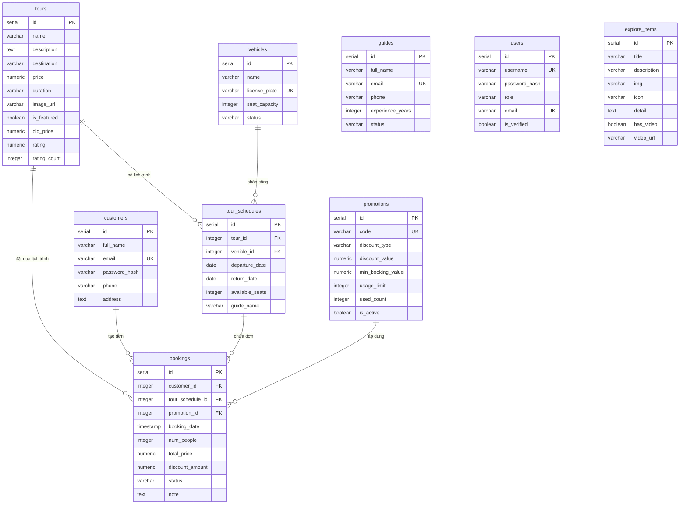

# 02. PHÂN TÍCH CHUYÊN SÂU DOCKER COMPOSE, POSTGRESQL VÀ NGINX REVERSE PROXY

---

## PHẦN 1. ĐIỀU PHỐI HỆ THỐNG VỚI DOCKER VÀ DOCKER COMPOSE

### 1.1. Bản chất kỹ thuật của Docker và Docker Compose
- **Docker Container:** Là một tiến trình (process) chạy cô lập trên nhân hệ điều hành Linux của máy host (hoặc máy ảo WSL2 trên Windows) nhờ vào hai tính năng cốt lõi của Linux Kernel:
  1. `Namespaces` (pid, net, ipc, mnt, uts): Cô lập không gian tên, giúp container nhìn thấy môi trường mạng riêng, cây tiến trình riêng, hệ thống file riêng.
  2. `Cgroups` (Control Groups): Giới hạn tài nguyên phần cứng (CPU, Memory, I/O) mà container được phép sử dụng. Ví dụ trong dự án: `backend` bị giới hạn tối đa `512M` RAM, `nginx` giới hạn `256M` RAM.
- **Docker Compose:** Là công cụ khai báo cấu hình đa container dưới dạng file YAML (`docker-compose.yml`). Thay vì phải gõ hàng chục lệnh `docker run` với các tham số cồng kềnh về port, volume, network, biến môi trường; Docker Compose cho phép khởi động, kết nối và quản trị toàn bộ 10 container chỉ với một lệnh duy nhất.

### 1.2. Phân biệt Port máy Host và Port nội bộ Container
Trong file `docker-compose.yml`, cú pháp ánh xạ cổng là: `"HOST_PORT:CONTAINER_PORT"`:
- **Port nội bộ (Container Port):** Là cổng mạng mà dịch vụ phần mềm bên trong container đang thực sự lắng nghe (bind). Cổng này chỉ có ý nghĩa bên trong mạng ảo của Docker.
- **Port máy host (Published Port):** Là cổng mở trên hệ điều hành máy tính vật lý. Khi có request gửi vào cổng này của máy host, Docker Engine (thông qua tiến trình `docker-proxy` và quy tắc `iptables/NAT`) sẽ chuyển tiếp (forward) gói tin vào cổng tương ứng của container.

**Ví dụ thực tế trong dự án:**
1. `nginx`: `"8888:8080"` -> Nginx bên trong container lắng nghe cổng `8080` (vì chạy non-root). Người dùng bên ngoài máy host truy cập qua `http://localhost:8888`.
2. `pgadmin`: `"5050:80"` -> pgAdmin bên trong container lắng nghe cổng `80`. Người dùng bên ngoài truy cập qua `http://localhost:5050`.
3. `postgres`: Dòng `ports: - "5433:5432"` đang bị **comment out (vô hiệu hóa)** trong file `docker-compose.yml`. Cổng `5432` của PostgreSQL hoàn toàn không được publish ra máy host. Điều này có nghĩa là từ bên ngoài máy tính (như phần mềm DBeaver hay Navicat trên máy thật), bạn không thể kết nối trực tiếp vào PostgreSQL nếu không mở port này; chỉ có các container nằm chung mạng `db-net` mới giao tiếp được với PostgreSQL qua cổng nội bộ `5432`. Đây là một biện pháp **Hardening (thu hẹp bề mặt tấn công)** rất chuẩn chỉ.

### 1.3. Cơ chế phân giải tên miền nội bộ (Docker Embedded DNS)
- **Vấn đề:** Tại sao container `backend` kết nối database lại dùng `host: 'postgres'` mà **KHÔNG ĐƯỢC** dùng `localhost`?
  - **Bản chất kỹ thuật:** Mỗi container sở hữu một `Network Namespace` riêng biệt với một card mạng ảo (`eth0`) và địa chỉ IP riêng (thường thuộc dải `172.x.x.x` hoặc `192.168.x.x`).
  - Khi mã nguồn trong container `backend` gọi `localhost` hoặc `127.0.0.1`, nó đang trỏ về chính bên trong container `backend` (chỉ có tiến trình Node.js đang chạy, không có cơ sở dữ liệu PostgreSQL nào ở đó cả!).
  - Docker cung cấp một DNS Server nội bộ tại địa chỉ `127.0.0.11`. Khi một container gửi truy vấn phân giải tên `postgres`, DNS của Docker sẽ tra cứu bảng ánh xạ trong mạng `db-net` và trả về đúng địa chỉ IP nội bộ của container `booking-postgres`.
  - Do đó, mọi kết nối giữa các container bắt buộc phải gọi bằng **Service Name** đã định nghĩa trong `docker-compose.yml` (`postgres`, `backend`, `frontend`, `prometheus`, `loki`).

### 1.4. Cơ chế phụ thuộc và kiểm tra sức khỏe (Healthcheck & depends_on)
- Trong Docker Compose bản cũ, `depends_on: ['postgres']` chỉ đảm bảo container `postgres` được tạo ra trước, nhưng không quan tâm dịch vụ PostgreSQL bên trong đã sẵn sàng nhận kết nối hay chưa. Hệ quả là Backend khởi động lên trước khi PostgreSQL kịp nạp xong, dẫn đến lỗi sập ứng dụng: `Connection refused on port 5432`.
- **Giải pháp xuất sắc trong dự án:**
  ```yaml
  # Trong service postgres:
  healthcheck:
    test: ["CMD-SHELL", "pg_isready -U booking_admin -d booking_tour"]
    interval: 10s
    timeout: 5s
    retries: 5

  # Trong service backend:
  depends_on:
    postgres:
      condition: service_healthy
  ```
  - Lệnh `pg_isready` gửi một truy vấn kiểm tra trực tiếp tới socket của PostgreSQL để đảm bảo cơ sở dữ liệu đã mở cửa nhận kết nối.
  - `backend` được cấu hình `condition: service_healthy`, Docker Compose sẽ đợi đến khi `pg_isready` trả về mã 0 thành công thì mới cho phép khởi chạy container `backend`.

---

## PHẦN 2. CƠ SỞ DỮ LIỆU POSTGRESQL VÀ PGADMIN

### 2.1. Cấu hình kết nối và biến môi trường
Trong `docker-compose.yml`, các biến môi trường cấu hình PostgreSQL được định nghĩa:
- `POSTGRES_DB: booking_tour`: Tên cơ sở dữ liệu chính.
- `POSTGRES_USER: booking_admin`: Người dùng quản trị sở hữu DB.
- `POSTGRES_PASSWORD: ${POSTGRES_PASSWORD:?...}`: Mật khẩu được đọc từ file `.env`. Cú pháp `:?` đảm bảo nếu file `.env` thiếu biến này thì Docker Compose sẽ báo lỗi ngay lập tức và dừng khởi chạy, không để hệ thống chạy với mật khẩu mặc định rỗng.

Trong mã nguồn Backend (`backend/src/db.js`):
```javascript
const { Pool } = require("pg");
require("dotenv").config();

const pool = new Pool({
  host: process.env.DB_HOST,       // Được docker-compose gán = "postgres"
  port: process.env.DB_PORT,       // Được docker-compose gán = 5432
  database: process.env.DB_NAME,   // Được docker-compose gán = "booking_tour"
  user: process.env.DB_USER,       // Được docker-compose gán = "booking_admin"
  password: process.env.DB_PASSWORD,// Đọc từ .env
});

module.exports = pool;
```
Backend sử dụng cơ chế **Connection Pool** từ thư viện `pg`. Pool duy trì sẵn một số lượng kết nối nhất định đến PostgreSQL, giúp tái sử dụng kết nối thay vì phải thực hiện bắt tay TCP 3 bước và xác thực lại cho mỗi lượt gọi API.

### 2.2. Cơ chế lưu trữ bền vững qua Docker Volume
- **Vấn đề:** Container là vô trạng thái (ephemeral). Nếu container bị xóa bằng lệnh `docker rm` hoặc `docker compose down`, toàn bộ file tạo ra bên trong container sẽ biến mất vĩnh viễn.
- **Giải pháp:** Sử dụng Docker Named Volume `postgres_data`.
  ```yaml
  volumes:
    - postgres_data:/var/lib/postgresql/data
  ```
  - Thư mục dữ liệu gốc `/var/lib/postgresql/data` của container được mount ra một vùng lưu trữ độc lập do Docker Engine quản lý trên ổ cứng máy host.
  - Ngay cả khi container bị xóa, volume `postgres_data` vẫn tồn tại nguyên vẹn. Khi khởi chạy lại một container mới và gắn vào volume này, toàn bộ dữ liệu lịch sử đặt tour, khách hàng, cấu hình đều được khôi phục ngay lập tức.
  - **Khởi tạo dữ liệu lần đầu:** File `./database/init.sql` được bind-mount dạng `:ro` (chỉ đọc) vào thư mục đặc biệt `/docker-entrypoint-initdb.d/init.sql`. Tiến trình khởi động của image `postgres:16` sẽ tự động quét thư mục này và chỉ thực thi script SQL một lần duy nhất nếu thư mục dữ liệu chưa từng tồn tại trước đó.

### 2.3. Quản trị qua pgAdmin 4
- Truy cập qua trình duyệt: `http://localhost:5050`
- Tài khoản đăng nhập pgAdmin: `admin@gmail.com`
- Mật khẩu: Đọc từ biến `PGADMIN_PASSWORD` trong file `.env` (mặc định mẫu là `your_secure_pgadmin_password`).
- **Cách kết nối pgAdmin tới PostgreSQL:**
  1. Đăng nhập vào giao diện web pgAdmin.
  2. Chọn *Add New Server*.
  3. Tab *General*: Đặt tên hiển thị bất kỳ (ví dụ: `BookingTourDB`).
  4. Tab *Connection*:
     - **Host name/address:** Điền `postgres` (Bắt buộc dùng tên service, KHÔNG được điền `localhost`).
     - **Port:** `5432` (Cổng nội bộ).
     - **Maintenance database:** `booking_tour`.
     - **Username:** `booking_admin`.
     - **Password:** Mật khẩu DB trong `.env`.

---

## PHẦN 3. PHÂN TÍCH SCHEMA CƠ SỞ DỮ LIỆU THỰC TẾ

*(Xác minh trực tiếp từ file `database/init.sql` và lệnh kiểm tra thực tế `psql -c "\dt"` trong container `booking-postgres`)*

Hệ thống bao gồm đúng **9 bảng dữ liệu** quan hệ:



### 3.1. Các bảng chính và mối quan hệ
1. `tours`: Chứa thông tin tour du lịch, giá cơ sở, lịch trình, hình ảnh và cờ `is_featured` để hiển thị ở trang chủ.
2. `tour_schedules`: Lịch khởi hành cụ thể của tour.
   - Khóa ngoại `tour_id REFERENCES tours(id) ON DELETE CASCADE`.
   - Khóa ngoại `vehicle_id REFERENCES vehicles(id) ON DELETE SET NULL`.
   - Quản lý số chỗ còn trống `available_seats`.
3. `customers`: Thông tin khách hàng đặt tour (Email là Unique, có lưu `password_hash` cho tài khoản đăng ký).
4. `bookings`: Quản lý đơn đặt tour.
   - Khóa ngoại `customer_id REFERENCES customers(id) ON DELETE CASCADE`.
   - Khóa ngoại `tour_schedule_id REFERENCES tour_schedules(id) ON DELETE CASCADE`.
   - Khóa ngoại `promotion_id REFERENCES promotions(id) ON DELETE SET NULL`.
   - Trạng thái `status`: `Pending`, `Confirmed`, `Cancelled`, `Completed`.
5. `promotions`: Quản lý mã giảm giá (giảm theo `%` hoặc số tiền cố định `fixed`).
6. `vehicles`: Danh sách xe phục vụ tour (biển số xe `license_plate` là Unique).
7. `guides`: Đội ngũ hướng dẫn viên du lịch.
8. `users`: Tài khoản quản trị nội bộ (`admin`, `staff`, `ketoan`), hỗ trợ xác thực mã OTP.
9. `explore_items`: Nội dung bài viết văn hóa / di tích Kinh Bắc trên trang chủ.

### 3.2. Ràng buộc toàn vẹn dữ liệu (Constraints) và Đánh chỉ mục (Indexes)
- **Ràng buộc CHECK:**
  - `chk_price`: Giá tour phải `>= 0`.
  - `chk_dates`: Ngày về phải sau hoặc bằng ngày đi (`return_date >= departure_date`).
  - `chk_seats`: Số ghế khả dụng không được âm (`available_seats >= 0`).
  - `chk_num_people`: Số người đặt trong 1 đơn phải `> 0`.
  - `chk_total_price`: Tổng tiền thanh toán phải `>= 0`.
- **Chỉ mục tối ưu hiệu năng (Performance Indexes):**
  - `idx_tours_is_featured`: Tăng tốc lọc tour nổi bật cho trang chủ.
  - `idx_tours_destination`: Tăng tốc tìm kiếm tour theo địa điểm.
  - `idx_tour_schedules_dates`: Tăng tốc tra cứu lịch khởi hành.
  - `idx_bookings_customer_id`: Tăng tốc xem lịch sử đơn của khách hàng.
  - `idx_customers_phone`, `idx_customers_email`: Tăng tốc tra cứu đơn công khai.

### 3.3. Xử lý Giao dịch và Khóa dòng bi quan (Pessimistic Locking)
Tại file `backend/src/controllers/bookingController.js`:
- Khi có nhiều khách hàng cùng bấm đặt tour vào một thời điểm (Race Condition):
  ```sql
  BEGIN;
  SELECT ts.available_seats, t.price 
  FROM tour_schedules ts 
  JOIN tours t ON ts.tour_id = t.id 
  WHERE ts.id = $1 FOR UPDATE;
  ```
- Từ khóa `FOR UPDATE` sẽ khóa dòng dữ liệu của lịch trình đó trong bảng `tour_schedules`. Các request khác muốn sửa hoặc đặt lịch trình này sẽ phải chờ giao dịch đầu tiên hoàn tất.
- Nếu `available_seats < peopleCount`, hệ thống thực hiện `ROLLBACK` và trả về lỗi `400` báo hết chỗ.
- Nếu đủ chỗ, hệ thống tính toán lại giá từ database (không tin giá gửi từ trình duyệt), trừ số chỗ khả dụng và ghi đơn vào bảng `bookings`, sau đó gọi `COMMIT`.

---

## PHẦN 4. NGINX REVERSE PROXY VÀ SECURITY HEADERS

### 4.1. Khái niệm Reverse Proxy
- **Forward Proxy:** Đứng trước các máy Client, làm đại diện cho Client để đi ra ngoài Internet (ví dụ: VPN trường học, công ty).
- **Reverse Proxy:** Đứng trước các máy chủ (Backend/Frontend), làm đại diện cho hệ thống máy chủ để tiếp nhận mọi request từ Internet và chuyển tiếp ngầm vào bên trong.
- **Lý do bắt buộc phải dùng Reverse Proxy:**
  1. **Một cổng duy nhất (Single Gateway):** Người dùng chỉ cần nhớ cổng `8888`.
  2. **Giải quyết triệt để lỗi CORS:** Cả giao diện và API đều có chung nguồn gốc `http://localhost:8888`.
  3. **Tăng cường bảo mật (Security Layer):** Che giấu hoàn toàn địa chỉ IP và cổng chạy của các container backend/database.
  4. **Gắn tiêu đề bảo mật tập trung:** Gắn các HTTP Security Headers một nơi cho toàn bộ hệ thống.

### 4.2. Phân tích chi tiết cấu hình `nginx/nginx.conf`

```nginx
pid /tmp/nginx.pid;
events {}

http {
    server {
        listen 8080;

        # --- KHỐI TIÊU ĐỀ BẢO MẬT (SECURITY HEADERS) ---
        add_header X-Frame-Options "SAMEORIGIN" always;
        add_header X-XSS-Protection "1; mode=block" always;
        add_header X-Content-Type-Options "nosniff" always;
        add_header Referrer-Policy "no-referrer-when-downgrade" always;
        add_header Content-Security-Policy "default-src 'self' http: https: data: blob: 'unsafe-inline' 'unsafe-eval'; frame-ancestors 'none';" always;
        add_header Permissions-Policy "geolocation=(), microphone=(), camera=()" always;

        # --- ĐỊNH TUYẾN FRONTEND (SPA REACT) ---
        location / {
            proxy_pass http://frontend:8080;
            proxy_set_header Host $host;
            proxy_set_header X-Real-IP $remote_addr;
            proxy_set_header X-Forwarded-For $proxy_add_x_forwarded_for;
            proxy_set_header X-Forwarded-Proto $scheme;
        }

        # --- ĐỊNH TUYẾN BACKEND (RESTful API) ---
        location /api/ {
            proxy_pass http://backend:3000;
            proxy_set_header Host $host;
            proxy_set_header X-Real-IP $remote_addr;
            proxy_set_header X-Forwarded-For $proxy_add_x_forwarded_for;
            proxy_set_header X-Forwarded-Proto $scheme;
        }

        # --- ĐỊNH TUYẾN FILE TĨNH UPLOAD ---
        location /uploads/ {
            proxy_pass http://backend:3000;
        }
    }
}
```

### 4.3. Giải thích từng chỉ thị (Directive)
1. `pid /tmp/nginx.pid;`: Chỉ định file lưu mã tiến trình PID của Nginx vào thư mục `/tmp`. **Đây là cấu hình bắt buộc khi chạy non-root (`nginx-unprivileged`)**, vì người dùng thường không có quyền ghi vào thư mục `/var/run/nginx.pid`.
2. `listen 8080;`: Nginx lắng nghe ở cổng `8080` bên trong container. Non-root user không được phép mở các cổng đặc quyền `< 1024` (như cổng 80), nên dùng 8080 và được Docker map ra `8888`.
3. `proxy_pass http://backend:3000;`: Chuyển tiếp toàn bộ request khớp với đường dẫn `/api/` tới container `backend` tại cổng 3000.
4. `proxy_set_header Host $host;`: Giữ nguyên tên miền/host gốc của client gửi lên thay vì đổi thành tên container nội bộ.
5. `proxy_set_header X-Real-IP $remote_addr;`: Gửi địa chỉ IP thật của máy người dùng vào header của request. Nhờ đó, Backend (thông qua `app.set('trust proxy', 1)`) biết được IP thật của người dùng để thực hiện giới hạn tần suất gửi yêu cầu (`rate-limit`).
6. `proxy_set_header X-Forwarded-For $proxy_add_x_forwarded_for;`: Danh sách IP qua các chuỗi proxy.

### 4.4. Phân tích chi tiết các Security Headers
- `X-Frame-Options: SAMEORIGIN`: Ngăn chặn website bị nhúng vào `<iframe>` của các trang web lừa đảo khác, triệt tiêu nguy cơ tấn công **Clickjacking** (đánh cắp cú nhấp chuột).
- `X-XSS-Protection: 1; mode=block`: Bật bộ lọc chống tấn công Cross-Site Scripting (XSS) trên các trình duyệt cũ.
- `X-Content-Type-Options: nosniff`: Ngăn trình duyệt tự ý suy đoán loại nội dung (MIME-type sniffing). Bắt buộc trình duyệt tuân thủ MIME-type do server trả về, ngăn chặn tấn công thực thi mã độc trá hình file ảnh.
- `Referrer-Policy: no-referrer-when-downgrade`: Bảo vệ quyền riêng tư, không gửi URL giới thiệu khi chuyển từ HTTPS sang HTTP.
- `Content-Security-Policy (CSP)`: Định nghĩa nguồn tài nguyên được phép thực thi trên trang. `frame-ancestors 'none'` chặn hoàn toàn việc nhúng iframe từ mọi nguồn.
- `Permissions-Policy`: Khóa các quyền truy cập nhạy cảm của trình duyệt (`geolocation=()`, `camera=()`, `microphone=()`).

### 4.5. Phân tích trạng thái HTTP vs HTTPS thực tế
- **Trạng thái thực tế:** Dự án đang chạy giao thức **HTTP thuần** ở cổng `8888` của máy host. **Dự án chưa cấu hình HTTPS / SSL-TLS**.
- **Giải thích với Giảng viên:**
  - Vì dự án được triển khai trên môi trường giả lập cục bộ (`localhost`), việc xin chứng chỉ SSL công khai (như Let's Encrypt qua Certbot) yêu cầu phải có tên miền công khai (FQDN) và mở cổng 80 ra internet, điều không khả thi trên máy tính cá nhân nội bộ.
  - Thay vì tự sinh chứng chỉ tự ký (Self-signed certificate) vốn gây cảnh báo bảo mật màu đỏ trên trình duyệt (`Your connection is not private`), dự án tập trung tối ưu hệ thống bảo vệ thông qua **Bộ 6 Tiêu đề Bảo mật HTTP (Security Headers)** và cơ chế **Non-root Container**, đảm bảo hệ thống vẫn có khả năng tự vệ vững chắc ở tầng ứng dụng.
- **Nếu triển khai HTTPS trong thực tế:** Cần bổ sung file chứng chỉ (`cert.pem`) và khóa bí mật (`key.pem`), đổi chỉ thị `listen 8080 ssl;`, cấu hình đường dẫn `ssl_certificate` và `ssl_certificate_key`, đồng thời thêm `server block` ở cổng 80 để chuyển hướng tự động (redirect 301) toàn bộ HTTP sang HTTPS.

---

## PHẦN 5. CÁC LỆNH KIỂM CHỨNG KỸ THUẬT THỰC TẾ

### 1. Kiểm tra header của Nginx từ máy host (PowerShell):
```powershell
curl.exe -I http://localhost:8888/
```
*Kết quả mong đợi:* Nhìn thấy `Server: nginx/1.31.6`, mã `HTTP/1.1 200 OK` và các dòng `X-Frame-Options`, `Content-Security-Policy`.

### 2. Kiểm tra định tuyến API qua Nginx (PowerShell):
```powershell
curl.exe -s -o $null -w "%{http_code}`n" http://localhost:8888/api/tours
```
*Kết quả mong đợi:* Trả về mã `200`.

### 3. Kiểm tra kết nối và bảng trong PostgreSQL từ dòng lệnh:
```powershell
docker exec booking-postgres psql -U booking_admin -d booking_tour -c "\dt"
```
*Kết quả mong đợi:* Hiển thị danh sách 9 bảng (`bookings`, `customers`, `tours`...).

### 4. Kiểm tra sức khỏe PostgreSQL:
```powershell
docker exec booking-postgres pg_isready -U booking_admin -d booking_tour
```
*Kết quả mong đợi:* `booking-postgres:5432 - accepting connections`.
