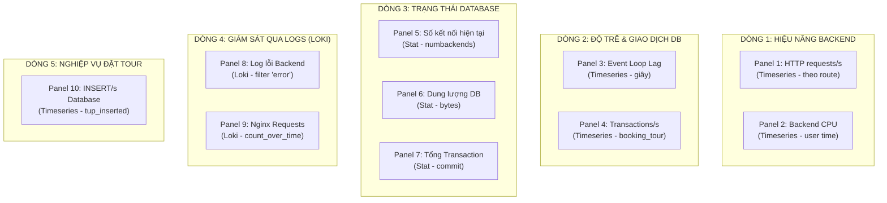

# 03. HỆ THỐNG GIÁM SÁT METRICS: PROMETHEUS VÀ GRAFANA

---

## PHẦN 1. BẢN CHẤT KỸ THUẬT CỦA PROMETHEUS

### 1.1. Prometheus là gì?
Prometheus là một hệ thống giám sát và cảnh báo mã nguồn mở, ban đầu được phát triển tại SoundCloud. Cốt lõi của Prometheus là một **Cơ sở dữ liệu chuỗi thời gian (Time-series Database - TSDB)**, chuyên lưu trữ các mẫu dữ liệu số thay đổi theo thời gian kèm theo các nhãn siêu dữ liệu (Labels).

### 1.2. Phân biệt Bản chất: Metrics vs Logs
| Tiêu chí | Metrics (Chỉ số) | Logs (Nhật ký) |
|---|---|---|
| **Định dạng dữ liệu** | Con số có cấu trúc (Numeric time-series) kèm nhãn: `http_requests_total{method="GET"} 45` | Chuỗi ký tự tự do (Text string / JSON): `"2026-10-13 12:15:41 GET /api/tours 200"` |
| **Cơ chế truyền nhận** | Kéo định kỳ (**Pull-based**): Prometheus chủ động gọi HTTP GET mỗi 15s. | Đẩy liên tục (**Push-based**): Ứng dụng in ra console, Promtail stream về Loki. |
| **Dung lượng lưu trữ** | Cực kỳ nhỏ gọn, không đổi theo số lượng người dùng truy cập. | Tăng tuyến tính theo lưu lượng truy cập; tốn nhiều dung lượng ổ cứng. |
| **Mục đích sử dụng** | Đo lường hiệu năng tổng quan, phát hiện xu hướng bất thường, kích hoạt cảnh báo (Alerting). | Điều tra nguyên nhân gốc rễ (Root Cause Analysis), tra cứu chi tiết ngữ cảnh lỗi. |

### 1.3. Cơ chế Scrape (Kéo dữ liệu)
Khác với nhiều công cụ giám sát truyền thống bắt máy chủ phải cài agent gửi dữ liệu đẩy (Push) về máy chủ trung tâm, Prometheus sử dụng mô hình **Kéo (Pull-based)**:
- Prometheus lưu sẵn danh sách các địa chỉ đích (Targets) trong file cấu hình `prometheus.yml`.
- Cứ sau mỗi chu kỳ `scrape_interval` (trong dự án cấu hình là **15 giây**), tiến trình Prometheus Scraper sẽ gửi một yêu cầu HTTP GET tới endpoint `/metrics` của từng Target.
- Dữ liệu trả về ở định dạng văn bản thuần chuẩn OpenMetrics/Prometheus. Prometheus tiến hành bóc tách các dòng chỉ số, gán nhãn thời gian hiện tại (`timestamp`) và lưu vào TSDB.

---

## PHẦN 2. CẤU HÌNH PROMETHEUS THỰC TẾ TRONG DỰ ÁN

*(Xác minh trực tiếp từ file `prometheus/prometheus.yml` và API `http://localhost:9090/api/v1/targets`)*

```yaml
global:
  scrape_interval: 15s

scrape_configs:
  - job_name: 'prometheus'
    static_configs:
      - targets: ['localhost:9090']

  - job_name: 'booking-backend'
    static_configs:
      - targets: ['backend:3000']

  - job_name: 'postgres'
    static_configs:
      - targets: ['postgres-exporter:9187']
```

### 2.1. Phân tích 3 Jobs giám sát thực tế
1. **Job 1: `prometheus` (Tự giám sát chính nó):**
   - **Target:** `localhost:9090/metrics`
   - **Mục đích:** Theo dõi sức khỏe của chính tiến trình Prometheus (tốc độ nuốt dữ liệu `prometheus_tsdb_head_samples_appended_total`, dung lượng RAM TSDB sử dụng).
2. **Job 2: `booking-backend` (Giám sát ứng dụng Node.js):**
   - **Target:** `backend:3000/metrics` (Sử dụng DNS nội bộ Docker `backend` qua mạng `backend-net`).
   - **Cơ chế thu thập:** Backend Node.js sử dụng thư viện `prom-client` tại file `backend/src/server.js`:
     - Tự động thu thập chỉ số hệ điều hành & Node.js runtime: `promClient.collectDefaultMetrics()`.
     - Chỉ số tự định nghĩa đo lường HTTP: `http_requests_total` (Counter) với 3 nhãn: `method` (GET/POST), `route` (ví dụ `/api/tours`), `status` (mã HTTP 200, 400, 500).
3. **Job 3: `postgres` (Giám sát cơ sở dữ liệu qua Postgres-Exporter):**
   - **Target:** `postgres-exporter:9187/metrics` (Sử dụng DNS nội bộ qua mạng `monitor-net`).
   - **Cơ chế thu thập:** Container `booking-postgres-exporter` duy trì kết nối trực tiếp vào `postgres:5432` bằng biến môi trường `DATA_SOURCE_NAME`. Exporter định kỳ chạy các câu lệnh SQL vào bảng hệ thống PostgreSQL (`pg_stat_database`, `pg_stat_activity`), chuyển đổi kết quả thành metrics chuẩn và mở cổng `9187` cho Prometheus scrape.

### 2.2. Giới hạn giám sát đã xác minh (Điểm cần lưu ý khi thi)
- **Chưa có Nginx Exporter:** Dự án không sử dụng `nginx-prometheus-exporter`, do đó Prometheus **không** lấy metrics trực tiếp từ Nginx. Thay vào đó, số lượng request qua Nginx được thống kê gián tiếp qua **Loki** (đọc log truy cập).
- **Chưa có cAdvisor / Node-Exporter:** Dự án không cấu hình exporter để đo tải CPU/RAM toàn bộ máy chủ vật lý hay từng container Docker riêng biệt; chỉ đo tải CPU/RAM của tiến trình Node.js do `prom-client` cung cấp.

### 2.3. Phân biệt: Container Up vs Target Prometheus UP
Đây là câu hỏi bẫy rất hay gặp của giảng viên:
- **Container có trạng thái `Up` (trong `docker compose ps`):** Chỉ biểu thị tiến trình chính của container đang sống (chưa bị crash hoặc thoát). Nó **không khẳng định** phần mềm bên trong đã sẵn sàng trả lời HTTP.
- **Target Prometheus có trạng thái `UP` (trong `localhost:9090/targets`):** Nghĩa là Prometheus vừa thực hiện một yêu cầu HTTP GET tới cổng `/metrics` của Target đó trong 15 giây gần nhất và nhận về mã phản hồi `HTTP 200 OK` với dữ liệu đúng định dạng. Target UP mới chứng minh luồng kết nối mạng và dịch vụ thực sự hoạt động tốt.

---

## PHẦN 3. GRAFANA VÀ DASHBOARD TỔNG QUAN

### 3.1. Cơ chế Tự động Nạp (Provisioning)
Trong môi trường sản xuất, quản trị viên không thể ngồi bấm tay cấu hình Datasource và Dashboard mỗi lần tạo lại container. Dự án đã áp dụng cơ chế **Provisioning chuyên nghiệp**:
1. **Datasources (`grafana/provisioning/datasources/datasources.yml`):**
   - Tự động khai báo Datasource `Prometheus` (UID: `booking-prometheus`, URL: `http://prometheus:9090`, đặt làm mặc định).
   - Tự động khai báo Datasource `Loki` (UID: `booking-loki`, URL: `http://loki:3100`).
2. **Dashboards (`grafana/provisioning/dashboards/dashboards.yml`):**
   - Định nghĩa nhà cung cấp (provider) nạp tự động toàn bộ file JSON từ thư mục `/var/lib/grafana/dashboards`.
   - Mount file `grafana/dashboards/booking-tour-overview.json` vào container, giúp Dashboard **"Booking Tour — Tổng quan hệ thống"** hiển thị sẵn sàng ngay khi vừa `docker compose up`.

---

### 3.2. Phân tích chi tiết 10 Panels trong Dashboard `booking-tour-overview.json`

*(Toàn bộ mã PromQL và LogQL dưới đây được trích xuất trực tiếp từ file cấu hình của dự án)*



#### Chi tiết từng Panel:

1. **Panel 1: "HTTP requests/s — Backend (theo route)"**
   - **Loại:** Timeseries | **Đơn vị:** reqps
   - **Câu truy vấn PromQL:**
     ```promql
     sum by (route) (rate(http_requests_total[5m]))
     ```
   - **Ý nghĩa:** Tính toán tốc độ request trung bình mỗi giây đến từng endpoint (`/api/tours`, `/api/bookings`, `/api/auth/login`) trong cửa sổ 5 phút gần nhất. Giúp phát hiện route nào đang chịu tải cao nhất.

2. **Panel 2: "Backend CPU (user time)"**
   - **Loại:** Timeseries | **Đơn vị:** percentunit
   - **Câu truy vấn PromQL:**
     ```promql
     rate(process_cpu_user_seconds_total[5m])
     ```
   - **Ý nghĩa:** Tỷ lệ thời gian CPU mà tiến trình Node.js sử dụng để thực thi mã nguồn JavaScript. Nếu chỉ số này chạm ngưỡng 1.0 (100% của 1 core CPU), backend có dấu hiệu quá tải tính toán.

3. **Panel 3: "Backend event loop lag (giây)"**
   - **Loại:** Timeseries | **Đơn vị:** s (giây)
   - **Câu truy vấn PromQL:**
     ```promql
     nodejs_eventloop_lag_seconds
     ```
   - **Ý nghĩa:** Đo độ trễ của vòng lặp sự kiện (Event Loop) trong Node.js. Vì Node.js là đơn luồng (Single-threaded), nếu có một tác vụ đồng bộ nặng (CPU-bound) chặn luồng, độ trễ này sẽ tăng vọt, báo hiệu ứng dụng đang bị nghẽn (freeze).

4. **Panel 4: "PostgreSQL — Transactions/s (booking_tour)"**
   - **Loại:** Timeseries | **Đơn vị:** ops
   - **Câu truy vấn PromQL:**
     ```promql
     rate(pg_stat_database_xact_commit{datname="booking_tour"}[5m])
     ```
   - **Ý nghĩa:** Tần suất các giao dịch (Transactions) được commit thành công mỗi giây vào database `booking_tour`. Khi khách hàng thực hiện đặt tour hoặc admin cập nhật dữ liệu, biểu đồ này sẽ tăng lên.

5. **Panel 5: "PostgreSQL — Số kết nối hiện tại"**
   - **Loại:** Stat (Con số đơn)
   - **Câu truy vấn PromQL:**
     ```promql
     pg_stat_database_numbackends{datname="booking_tour"}
     ```
   - **Ý nghĩa:** Số lượng client TCP đang kết nối đồng thời vào cơ sở dữ liệu (bao gồm Backend Connection Pool, pgAdmin, và Postgres-Exporter). Giúp cảnh báo sớm tình trạng cạn kiệt connection pool.

6. **Panel 6: "PostgreSQL — Dung lượng DB"**
   - **Loại:** Stat | **Đơn vị:** bytes (Grafana tự quy đổi KB, MB)
   - **Câu truy vấn PromQL:**
     ```promql
     pg_database_size_bytes{datname="booking_tour"}
     ```
   - **Ý nghĩa:** Tổng kích thước vật lý của cơ sở dữ liệu `booking_tour` trên ổ cứng.

7. **Panel 7: "PostgreSQL — Tổng transactions đã commit"**
   - **Loại:** Stat
   - **Câu truy vấn PromQL:**
     ```promql
     pg_stat_database_xact_commit{datname="booking_tour"}
     ```
   - **Ý nghĩa:** Tổng số giao dịch ghi thành công kể từ khi container database khởi động.

8. **Panel 8: "Backend logs — dòng log chứa 'error' (Loki)"**
   - **Loại:** Timeseries | **Datasource:** Loki
   - **Câu truy vấn LogQL:**
     ```logql
     sum(count_over_time({container_name="booking-backend"} |= "error" [5m]))
     ```
   - **Ý nghĩa:** Đếm số dòng log xuất hiện chữ `"error"` từ container Backend trong 5 phút. Nếu biểu đồ này xuất hiện cột sóng lớn, quản trị viên biết ngay ứng dụng đang quăng lỗi hàng loạt.

9. **Panel 9: "Nginx requests (Loki) — số request qua gateway"**
   - **Loại:** Timeseries | **Datasource:** Loki
   - **Câu truy vấn LogQL:**
     ```logql
     sum(count_over_time({container_name="booking-nginx"} [5m]))
     ```
   - **Ý nghĩa:** Thống kê tổng số request HTTP đi qua cổng Nginx Gateway. Đây là giải pháp kết hợp thông minh thay thế cho việc thiếu Nginx Exporter.

10. **Panel 10: "PostgreSQL — INSERT/s (booking_tour): đặt tour mới sẽ tăng"**
    - **Loại:** Timeseries | **Đơn vị:** ops
    - **Câu truy vấn PromQL:**
      ```promql
      rate(pg_stat_database_tup_inserted{datname="booking_tour"}[5m])
      ```
    - **Ý nghĩa:** Tần suất chèn bản ghi mới (INSERT) mỗi giây vào DB. Mỗi khi sinh viên bấm tạo một đơn đặt tour mới trên giao diện, chỉ số này sẽ lập tức nhảy vọt. Đây là minh chứng hoàn hảo để biểu diễn trong buổi bảo vệ thi vấn đáp!

---

## PHẦN 4. HƯỚNG DẪN KIỂM TRA THỰC HÀNH KHI BẢO VỆ

### 1. Kiểm tra 3 Target Prometheus bằng PowerShell:
```powershell
curl.exe -s http://localhost:9090/api/v1/targets | Select-String '"health":"up"'
```
*Kết quả:* Sẽ thấy 3 kết quả `health: up` tương ứng với `booking-backend`, `postgres`, `prometheus`.

### 2. Kiểm tra trực tiếp dữ liệu metrics của Backend:
```powershell
curl.exe -s http://localhost:3000/metrics | Select-String "http_requests_total"
```
*Kết quả:* Nhìn thấy các dòng đếm request dạng:
`http_requests_total{method="GET",route="/api/tours",status="200"} 12`

### 3. Kiểm tra metrics từ Postgres-Exporter (qua Docker exec):
```powershell
docker exec booking-prometheus wget -qO- http://postgres-exporter:9187/metrics | grep "pg_stat_database_numbackends"
```
*Kết quả:* Nhìn thấy chỉ số số kết nối database của `booking_tour`.
