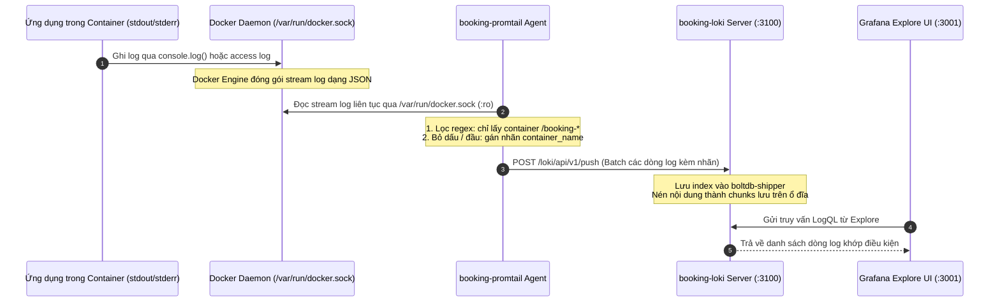

# 04. HỆ THỐNG QUẢN TRỊ LOG TẬP TRUNG: LOKI, PROMTAIL VÀ LOGQL

---

## PHẦN 1. BẢN CHẤT CỦA QUẢN TRỊ LOG TẬP TRUNG

### 1.1. Log tập trung (Centralized Logging) là gì?
Trong kiến trúc đơn khối (Monolithic), toàn bộ log ứng dụng thường được ghi vào một hoặc hai file cục bộ trên máy chủ (ví dụ `/var/log/app.log`). Tuy nhiên, trong kiến trúc hướng dịch vụ hoặc container hóa với Docker Compose:
- Hệ thống bị phân tán thành 10 container độc lập chạy song song.
- Mỗi container có vòng đời riêng; nếu một container gặp sự cố nghiêm trọng và bị crash hoặc recreate, toàn bộ file log cục bộ bên trong container có thể bị mất.
- **Quản trị log tập trung** là giải pháp tự động thu thập, tập hợp toàn bộ các luồng sự kiện (logs) từ tất cả các container về một kho lưu trữ tập trung duy nhất theo thời gian thực, cho phép tìm kiếm, lọc và phân tích tương quan giữa các dịch vụ trên một giao diện web duy nhất.

### 1.2. Ba trụ cột của khả năng quan sát hệ thống (The 3 Pillars of Observability)
| Trụ cột | Bản chất | Câu hỏi giải quyết | Công cụ trong dự án |
|---|---|---|---|
| **Metrics** (Chỉ số) | Dữ liệu số đo lường hiệu năng theo thời gian | *"Hệ thống có đang gặp vấn đề không? Tải bao nhiêu?"* | **Prometheus + Grafana** |
| **Logs** (Nhật ký) | Bản ghi chi tiết các sự kiện cụ thể có kèm ngữ cảnh | *"Chuyện gì đã xảy ra tại thời điểm đó và ở đâu?"* | **Promtail + Loki** |
| **Traces** (Dấu vết) | Theo dõi hành trình 1 request đi qua các microservices | *"Request bị chậm ở đoạn mã hay service nào?"* | *(Chưa áp dụng trong đề tài)* |

### 1.3. Tại sao chọn Loki thay vì ELK Stack (Elasticsearch - Logstash - Kibana)?
- **Elasticsearch:** Đánh chỉ mục toàn bộ nội dung văn bản của từng dòng log (Full-text indexing). Cơ chế này đòi hỏi dung lượng bộ nhớ RAM cực lớn (tối thiểu 4GB - 8GB) và dung lượng ổ cứng phình to rất nhanh, dễ làm quá tải máy tính sinh viên khi chạy demo.
- **Grafana Loki:** Được mệnh danh là "Prometheus dành cho Logs". Loki **KHÔNG** đánh chỉ mục toàn văn nội dung log, mà chỉ đánh chỉ mục cho các nhãn siêu dữ liệu (Labels) giống như Prometheus (ví dụ `container_name="booking-backend"`). Nội dung log được nén thành các khối (chunks) lưu trực tiếp xuống filesystem. Nhờ đó, Loki tiêu thụ tài nguyên RAM cực kỳ thấp (chỉ ~30MB - 50MB RAM) mà vẫn đảm bảo tốc độ truy vấn vượt trội.

---

## PHẦN 2. LUỒNG THU THẬP LOG THỰC TẾ TRONG DỰ ÁN



### 2.1. Phân tích chi tiết file cấu hình Promtail (`promtail/promtail-config.yml`)

```yaml
server:
  http_listen_port: 9080
  grpc_listen_port: 0

positions:
  filename: /tmp/positions.yaml

clients:
  - url: http://loki:3100/loki/api/v1/push

scrape_configs:
  - job_name: docker
    docker_sd_configs:
      - host: unix:///var/run/docker.sock
        refresh_interval: 5s
    relabel_configs:
      # Chỉ thu log các container của project booking-tour (bỏ qua container khác)
      - source_labels: ['__meta_docker_container_name']
        regex: '/booking-.*'
        action: keep
      - source_labels: ['__meta_docker_container_name']
        regex: '/(.*)'
        target_label: 'container_name'
```

#### Ý nghĩa từng khối cấu hình:
1. `positions.filename: /tmp/positions.yaml`: File ghi nhớ vị trí con trỏ (offset) của từng stream log. Nếu Promtail bị khởi động lại, nó sẽ đọc tiếp từ vị trí byte cuối cùng đã gửi, không làm mất log và không gửi trùng lặp log lên Loki.
2. `clients.url: http://loki:3100/loki/api/v1/push`: Địa chỉ endpoint nhận log của Loki. Sử dụng tên service `loki` trong mạng nội bộ `monitor-net`.
3. `docker_sd_configs`: Cơ chế tự động phát hiện container của Docker (Docker Service Discovery). Promtail kết nối vào socket Unix `unix:///var/run/docker.sock` và quét danh sách container mỗi `5 giây`.
4. `relabel_configs`:
   - **Quy tắc 1 (Lọc rác):** `source_labels: ['__meta_docker_container_name']`, `regex: '/booking-.*'`, `action: keep`.
     - *Bản chất kỹ thuật:* Trên máy tính của sinh viên hoặc máy chủ có thể đang chạy nhiều container của các môn học hoặc dự án khác. Quy tắc này ra lệnh cho Promtail **CHỈ GIỮ LẠI** và thu thập log của các container có tên bắt đầu bằng tiền tố `/booking-` (như `booking-backend`, `booking-nginx`, `booking-postgres`). Mọi container khác đều bị bỏ qua.
   - **Quy tắc 2 (Chuẩn hóa nhãn):** `regex: '/(.*)'`, `target_label: 'container_name'`.
     - *Bản chất kỹ thuật:* Tên container trong Docker Engine luôn có dấu gạch chéo ở đầu (ví dụ `/booking-backend`). Biểu thức chính quy này bóc tách dấu `/` và gán tên sạch sẽ `booking-backend` vào nhãn chính thức `container_name`.

### 2.2. Phân tích cấu hình Loki (`loki/loki-config.yml`)
- Cổng lắng nghe: `http_listen_port: 3100`.
- Cơ chế lưu trữ: Sử dụng `boltdb-shipper` cho index và `filesystem` cho lưu trữ chunks trong volume `loki_data` gắn vào `/loki`.
- `auth_enabled: false`: Chạy chế độ đơn người dùng (single-tenant), phù hợp cho môi trường triển khai nội bộ.
- `allow_structured_metadata: false`: Đảm bảo tương thích ngược với định dạng schema v11 của boltdb-shipper.

---

## PHẦN 3. NGÔN NGỮ TRUY VẤN LOGQL VÀ CÁC TRUY VẤN THỰC TẾ

### 3.1. LogQL là gì?
LogQL (Loki Query Language) là ngôn ngữ truy vấn của Loki, được thiết kế với cú pháp và triết lý lấy cảm hứng trực tiếp từ PromQL của Prometheus.

Cấu trúc cơ bản của một câu truy vấn LogQL:
```text
{ stream_selector } |= "search_string" |~ "regex_pattern"
```
- **Stream Selector (Bộ chọn luồng):** Đặt trong cặp ngoặc nhọn `{}` để lọc theo nhãn (labels). Ví dụ: `{container_name="booking-backend"}`.
- **Log Pipeline Filters (Bộ lọc nội dung dòng log):**
  - `|=`: Chứa chuỗi ký tự (Case-sensitive text filter).
  - `!=`: Không chứa chuỗi ký tự.
  - `|~`: Khớp biểu thức chính quy Regex.
  - `!~`: Không khớp biểu thức chính quy Regex.

---

### 3.2. Trích xuất và giải thích 4 Truy vấn LogQL thực tế trong dự án

*(Toàn bộ các truy vấn dưới đây sử dụng đúng 100% nhãn `container_name` thực tế của dự án)*

#### Truy vấn 1: Lấy toàn bộ log của Nginx Reverse Proxy Gateway
```logql
{container_name="booking-nginx"}
```
- **Ý nghĩa từng thành phần:**
  - `{}`: Định nghĩa bộ chọn nhãn.
  - `container_name="booking-nginx"`: Lọc chính xác luồng log được gửi từ container `booking-nginx`.
- **Dữ liệu trả về:** Toàn bộ nhật ký truy cập HTTP (Access Log) và nhật ký lỗi (Error Log) đi qua cổng Gateway 8888. Ví dụ:
  `172.30.0.1 - - [13/Oct/2026:12:15:41 +0000] "GET /api/tours HTTP/1.1" 200 6249 "-" "curl/8.21.0"`
- **Khi nào sử dụng:** Khi muốn chứng minh với giảng viên rằng lượt click từ trình duyệt thực sự đã đi qua Nginx.
- **Nếu không có kết quả:** Kiểm tra xem đã truy cập website chưa, hoặc mở rộng khoảng thời gian ở góc trên bên phải Grafana (chọn *Last 1 hour*).

---

#### Truy vấn 2: Truy vấn log tìm kiếm lỗi trong Backend API
```logql
{container_name="booking-backend"} |= "error"
```
*(Hoặc không phân biệt hoa thường bằng Regex)*:
```logql
{container_name="booking-backend"} |~ "(?i)error"
```
- **Ý nghĩa từng thành phần:**
  - `{container_name="booking-backend"}`: Chọn luồng log của API Node.js.
  - `|= "error"`: Bộ lọc dòng văn bản, chỉ giữ lại những dòng log có chứa chuỗi chữ `"error"`.
  - `|~ "(?i)error"`: Biểu thức chính quy với cờ `(?i)` (ignore case), bắt cả `Error`, `ERROR`, `error`.
- **Dữ liệu trả về:** Các ngoại lệ chưa bắt (Unhandled exceptions), lỗi cú pháp SQL, hoặc lỗi kết nối SMTP khi gửi email.
- **Khi nào sử dụng:** Khi API trả về mã lỗi 500 hoặc khi người dùng đặt tour không thành công mà không rõ nguyên nhân.

---

#### Truy vấn 3: Lọc log các request gọi vào API qua Nginx
```logql
{container_name="booking-nginx"} |= "GET /api/"
```
- **Ý nghĩa từng thành phần:**
  - `{container_name="booking-nginx"}`: Chọn luồng log Nginx.
  - `|= "GET /api/"`: Chỉ lọc các request có phương thức GET gọi vào nhóm route `/api/` (như `/api/tours`, `/api/explore`).
- **Dữ liệu trả về:** Danh sách các request đọc dữ liệu API của khách hàng.
- **Ý nghĩa kiểm thử:** Chứng minh khối cấu hình `location /api/ { proxy_pass http://backend:3000; }` trong `nginx.conf` đang bắt đúng đường dẫn và chuyển tiếp thành công.

---

#### Truy vấn 4: Đếm tần suất log lỗi Backend theo thời gian (Metric Query từ Log)
```logql
sum(count_over_time({container_name="booking-backend"} |= "error" [5m]))
```
- **Ý nghĩa từng thành phần:**
  - `count_over_time(... [5m])`: Hàm biến đổi log thành dạng số (Metrics), đếm số dòng log khớp bộ lọc trong mỗi khoảng thời gian 5 phút.
  - `sum(...)`: Tính tổng số lượng.
- **Dữ liệu trả về:** Một đồ thị đường (Timeseries) thể hiện số lượng lỗi theo thời gian (Chính là câu lệnh được nhúng trong Panel 8 của Dashboard Grafana!).
- **Khi nào sử dụng:** Khi muốn biến các sự kiện log thành biểu đồ trực quan để quan sát xu hướng lỗi của hệ thống.

---

## PHẦN 4. QUY TRÌNH THAO TÁC TRUY VẤN TRÊN GRAFANA EXPLORE

Khi bước vào phòng thi vấn đáp, nếu giảng viên yêu cầu: *"Em hãy mở giao diện và truy vấn cho thầy xem log của Nginx và Backend"*, sinh viên thực hiện đúng 5 bước sau:

1. Mở trình duyệt, truy cập `http://localhost:3001` (Grafana).
2. Đăng nhập với tài khoản: `admin` / `admin`.
3. Nhìn sang thanh menu bên trái, nhấp vào biểu tượng la bàn **Explore** (hoặc gõ trực tiếp URL `http://localhost:3001/explore`).
4. Tại ô chọn nguồn dữ liệu ở góc trên bên trái màn hình, chọn **Loki** (đã được cấu hình tự động).
5. Nhập câu truy vấn vào ô nhập liệu:
   `{container_name="booking-nginx"}`
   Sau đó bấm nút xanh **Run query** (hoặc ấn `Shift + Enter`).
6. Kéo xuống phần dưới màn hình để chỉ cho thầy các dòng log thời gian thực hiển thị mã HTTP 200, IP truy cập và đường dẫn request.

---

## PHẦN 5. CÁC LỆNH KIỂM CHỨNG LOKI BẰNG DÒNG LỆNH (POWERSHELL)

### 1. Kiểm tra danh sách nhãn (Labels) mà Loki đang lưu trữ:
```powershell
curl.exe -s http://localhost:3100/loki/api/v1/labels
```
*Kết quả trả về:* `{"status":"success","data":["container_name","service_name"]}`

### 2. Kiểm tra danh sách container đã nạp log vào Loki:
```powershell
curl.exe -s http://localhost:3100/loki/api/v1/label/container_name/values
```
*Kết quả trả về:* Đầy đủ 10 container (`booking-backend`, `booking-frontend`, `booking-nginx`, `booking-postgres`...).

### 3. Chạy thử truy vấn LogQL trực tiếp qua API của Loki:
```powershell
curl.exe -s -G "http://localhost:3100/loki/api/v1/query_range" --data-urlencode "query={container_name=`"booking-nginx`"}" --data-urlencode "limit=2"
```
*Kết quả trả về:* Mã JSON chứa 2 dòng log truy cập mới nhất của Nginx.
