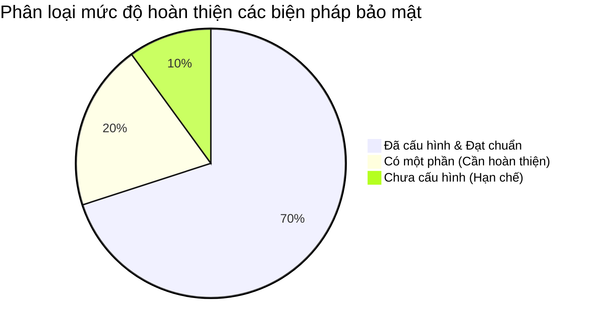
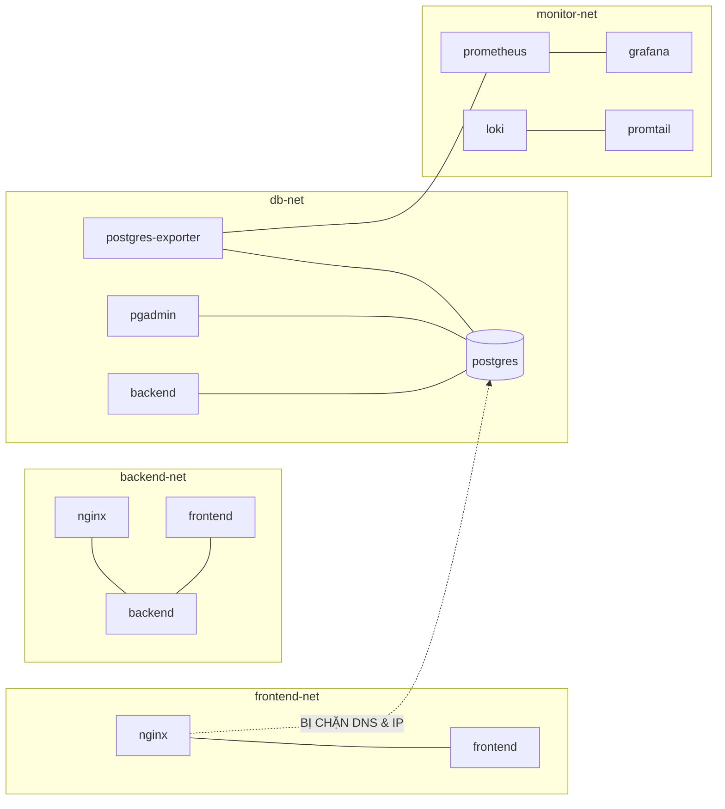

# 05. BẢO MẬT HỆ THỐNG VÀ CÁC BIỆN PHÁP HARDENING

---

## PHẦN 1. TỔNG QUAN VỀ HARDENING VÀ NGUYÊN TẮC BẢO MẬT ĐA TẦNG

**Hardening (Làm cứng hệ thống):** Là quá trình rà soát, loại bỏ các cấu hình mặc định thiếu an toàn, vô hiệu hóa các cổng và dịch vụ không cần thiết, giới hạn tối đa quyền hạn của tiến trình và thu hẹp bề mặt tấn công (Attack Surface).

Trong đề tài số 20, hệ thống triển khai theo mô hình **Phòng thủ đa tầng (Defense in Depth)** từ tầng hạ tầng Docker, tầng mạng, tầng máy chủ Proxy, cho đến tầng ứng dụng và cơ sở dữ liệu.

---

## PHẦN 2. PHÂN LOẠI VÀ ĐÁNH GIÁ CÁC BIỆN PHÁP BẢO MẬT THỰC TẾ

*(Tuân thủ nghiêm ngặt nguyên tắc: Phân loại theo 3 trạng thái rõ ràng, dựa trên bằng chứng kỹ thuật đã kiểm chứng)*



| STT | Biện pháp Hardening | Phân loại trạng thái | File cấu hình liên quan | Bằng chứng kỹ thuật thực tế |
|---|---|---|---|---|
| 1 | **Non-root Container** | **Đã cấu hình và có bằng chứng** | `backend/Dockerfile`, `frontend/Dockerfile`, `docker-compose.yml` | Container chạy UID 1000 (`node`) và UID 101 (`nginx`). |
| 2 | **Network Isolation (Cô lập mạng)** | **Đã cấu hình và có bằng chứng** | `docker-compose.yml` | Phân 4 mạng riêng biệt; Nginx ping `postgres` bị lỗi `bad address`. |
| 3 | **Giới hạn Port Exposure** | **Đã cấu hình và có bằng chứng** | `docker-compose.yml` | Port 5432 (Postgres), 8080 (Frontend) đã bị đóng ra máy host. |
| 4 | **Bảo vệ Secrets & .env** | **Đã cấu hình và có bằng chứng** | `.gitignore`, `.env.example`, `docker-compose.yml` | `.env` nằm trong `.gitignore`; compose dùng cú pháp `${VAR:?err}`. |
| 5 | **Read-Only Mounts (:ro)** | **Đã cấu hình và có bằng chứng** | `docker-compose.yml` | Mount `init.sql:ro`, `nginx.conf:ro`, `docker.sock:ro`. |
| 6 | **HTTP Security Headers** | **Đã cấu hình và có bằng chứng** | `nginx/nginx.conf` | `curl -I` trả về 6 tiêu đề CSP, X-Frame-Options, XSS, nosniff... |
| 7 | **Bảo vệ Ứng dụng & API** | **Đã cấu hình và có bằng chứng** | `backend/src/middleware/`, `routes/uploadRoutes.js` | JWT HttpOnly, Rate Limiter chống DoS/Brute Force, Whitelist Upload. |
| 8 | **Resource Limits (Giới hạn tài nguyên)** | **Có một phần nhưng chưa đầy đủ** | `docker-compose.yml` | Có limit RAM cho `backend` (512M) và `nginx` (256M); chưa limit cho `postgres`. |
| 9 | **Database Least Privilege** | **Có một phần nhưng chưa đầy đủ** | `docker-compose.yml`, `database/init.sql` | Dùng user riêng `booking_admin` (không dùng `postgres`), nhưng user này nắm toàn quyền DB. |
| 10 | **Cấu hình HTTPS / SSL-TLS** | **Chưa cấu hình (Hạn chế đã biết)** | `nginx/nginx.conf` | Hệ thống chạy HTTP cổng 8888 (đã nêu trung thực trong README). |

---

## PHẦN 3. PHÂN TÍCH CHUYÊN SÂU TỪNG BIỆN PHÁP BẢO MẬT

### 3.1. Chạy Container với Người dùng không đặc quyền (Non-root Containers)
- **Rủi ro cần xử lý:** Mặc định, nếu không khai báo người dùng, các tiến trình trong container sẽ chạy dưới quyền `root` (UID 0). Nếu hacker tìm ra lỗ hổng bảo mật (ví dụ Remote Code Execution) để chiếm quyền container, chúng có thể tận dụng các lỗ hổng nhân Linux (Container Escape) để chiếm toàn quyền điều khiển máy tính vật lý (Host Root).
- **Cấu hình thực tế trong dự án:**
  1. `backend/Dockerfile`:
     ```dockerfile
     FROM node:22-alpine
     WORKDIR /app
     COPY package*.json ./
     RUN npm ci
     COPY . .
     USER node          # Chuyển quyền sang user node (UID 1000)
     CMD ["npm", "start"]
     ```
  2. `frontend/Dockerfile` và `docker-compose.yml`: Sử dụng image chính thức `nginxinc/nginx-unprivileged:alpine`. Image này tự động khởi chạy Nginx dưới người dùng `nginx` (UID 101).
- **Cách kiểm chứng thực tế:**
  ```powershell
  docker exec booking-backend id
  # Kết quả: uid=1000(node) gid=1000(node)
  docker exec booking-nginx id
  # Kết quả: uid=101(nginx) gid=101(nginx)
  ```
- **Hạn chế còn tồn tại:** Container `postgres` tiến trình khởi động chạy dưới root để chuẩn bị quyền thư mục `/var/lib/postgresql/data`, sau đó mới hạ quyền xuống user `postgres` (UID 70).

---

### 3.2. Cô lập Mạng Docker đa tầng (Docker Network Isolation)
- **Rủi ro cần xử lý:** Trong một hệ thống phẳng (chỉ dùng mạng mặc định `default bridge`), nếu container Frontend hoặc Nginx bị xâm nhập, kẻ tấn công có thể quét trực tiếp địa chỉ IP nội bộ và tấn công thẳng vào cổng `5432` của Database.
- **Cấu hình thực tế trong dự án:** Chia thành 4 mạng độc lập:
  - `frontend-net`: Nơi Nginx tiếp nhận và định tuyến giao diện sang Frontend.
  - `backend-net`: Nơi Nginx và Frontend chuyển tiếp request vào Backend API.
  - `db-net`: Mạng riêng biệt chỉ cấp quyền cho 3 service: `backend`, `pgadmin`, `postgres-exporter` và `postgres`. Nginx và Frontend **tuyệt đối không thuộc mạng này**.
  - `monitor-net`: Mạng giám sát nội bộ kết nối Prometheus, Grafana, Loki và Promtail.



- **Cách kiểm chứng thực tế:** Đứng từ container Nginx thực hiện ping tới Database:
  ```powershell
  docker exec booking-nginx ping -c 1 postgres
  ```
  *Kết quả trả về:* `ping: bad address 'postgres'`. Nginx thậm chí không thể phân giải tên miền của PostgreSQL qua DNS Docker, chứng minh rào cản cô lập mạng hoạt động hoàn hảo.

---

### 3.3. Thu hẹp bề mặt cổng mạng (Minimal Published Ports)
- **Rủi ro:** Để lộ cổng cơ sở dữ liệu `5432` ra máy host giúp hacker dễ dàng thực hiện tấn công dò mật khẩu (Brute-force) hoặc khai thác lỗ hổng từ xa.
- **Cấu hình thực tế:**
  - Trong `docker-compose.yml`, các dòng publish cổng nội bộ đã được đóng lại:
    - Service `postgres`: Dòng `ports: - "5433:5432"` đã được comment.
    - Service `frontend`: Dòng `ports: - "8082:8080"` đã được comment.
    - Service `postgres-exporter`: Dòng `ports: - "9187:9187"` đã được comment.
  - Người dùng bên ngoài chỉ có thể đi qua một cổng duy nhất là **Nginx Gateway (8888)**.

---

### 3.4. Quản lý Mật khẩu và Biến môi trường An toàn
- **Rủi ro:** Lộ mật khẩu cơ sở dữ liệu, JWT Secret hoặc mật khẩu email SMTP khi đưa mã nguồn lên GitHub công khai.
- **Cấu hình thực tế:**
  1. File `.gitignore` đã có dòng khai báo `.env`. File `.env` chứa mật khẩu thực tế không bao giờ xuất hiện trong Git commit.
  2. Cung cấp file mẫu `.env.example` chỉ chứa tên biến và giá trị giữ chỗ giả định.
  3. Cú pháp bảo vệ cưỡng bức trong `docker-compose.yml`:
     ```yaml
     POSTGRES_PASSWORD: ${POSTGRES_PASSWORD:?Thiếu POSTGRES_PASSWORD trong .env — xem .env.example}
     ```
     Nếu lập trình viên quên tạo file `.env`, Docker Compose sẽ lập tức báo lỗi và từ chối khởi chạy, ngăn ngừa rủi ro chạy hệ thống với mật khẩu rỗng mặc định.

---

### 3.5. Gắn kết hệ thống tập tin chỉ đọc (Read-Only Mounts)
- **Rủi ro:** Kẻ tấn công lợi dụng lỗ hổng để ghi đè file cấu hình hệ thống (như chèn backdoor vào `nginx.conf` hoặc `init.sql`).
- **Cấu hình thực tế:**
  - `./nginx/nginx.conf:/etc/nginx/nginx.conf:ro` (Chỉ đọc)
  - `./database/init.sql:/docker-entrypoint-initdb.d/init.sql:ro` (Chỉ đọc)
  - `/var/run/docker.sock:/var/run/docker.sock:ro` (Chỉ đọc)
  - **Ý nghĩa đặc biệt của `docker.sock:ro`:** Promtail chỉ cần quyền đọc để lấy stream log container. Việc gắn cờ `:ro` ngăn chặn Promtail hoặc kẻ tấn công chiếm quyền Promtail gửi các lệnh điều khiển Docker API để tạo container mới hay xóa hệ thống.

---

### 3.6. Bộ tiêu đề Bảo mật HTTP (Security Headers) tại Nginx
- **Cấu hình thực tế trong `nginx/nginx.conf`:**
  - `X-Frame-Options: SAMEORIGIN`: Chống Clickjacking.
  - `X-XSS-Protection: 1; mode=block`: Bật bộ lọc chống XSS.
  - `X-Content-Type-Options: nosniff`: Chống MIME-sniffing.
  - `Referrer-Policy: no-referrer-when-downgrade`: Bảo vệ thông tin URL người dùng.
  - `Content-Security-Policy: default-src 'self' ... frame-ancestors 'none';`: Khóa chặt nguồn tài nguyên được phép thực thi.
  - `Permissions-Policy: geolocation=(), microphone=(), camera=()`: Khóa phần cứng thiết bị.
- **Cách kiểm chứng:**
  ```powershell
  curl.exe -I http://localhost:8888/
  ```

---

### 3.7. Các biện pháp bảo vệ ở tầng Ứng dụng Backend
1. **Băm mật khẩu an toàn:** Sử dụng thư viện `bcryptjs` với salt rounds để mã hóa mật khẩu người dùng trước khi lưu vào bảng `users` và `customers`.
2. **Xác thực Cookie HttpOnly & Phân tách Token:**
   - Token đăng nhập của nhân viên (`typ='admin'`) và token khách hàng (`typ='customer'`) được lưu trong cookie trình duyệt với cờ `httpOnly: true`. Mã JavaScript trên trình duyệt không thể đọc được cookie này, miễn nhiễm hoàn toàn với các cuộc tấn công đánh cắp token qua lỗ hổng XSS.
3. **Chống Brute-force và DoS qua Rate Limiting (`backend/src/middleware/rateLimiter.js`):**
   - Đăng nhập/OTP: Tối đa 10 lượt thử trong 15 phút (`loginLimiter`).
   - Đặt tour: Tối đa 10 lượt tạo đơn trong 15 phút (`bookingLimiter`).
   - Tra cứu mã đơn: Có rate limit ngăn chặn bot quét mã đơn.
4. **Bảo mật Tải lên File (`backend/src/routes/uploadRoutes.js`):**
   - Chỉ cho phép Admin/Staff có token hợp lệ mới được tải ảnh lên.
   - Whitelist định dạng nghiêm ngặt: chỉ nhận `image/jpeg`, `image/png`, `image/gif`, `image/webp`.
   - Phần mở rộng của file lưu trữ (`.jpg`, `.png`) được gán cố định từ MIME-type do server kiểm tra, **tuyệt đối không lấy từ tên file của người dùng gửi lên** (chống kỹ thuật tải file `.php` hoặc script thực thi trá hình).
   - Giới hạn kích thước file tối đa: `5MB`.
5. **Chống SQL Injection:** Toàn bộ các truy vấn trong backend sử dụng cơ chế truyền tham số (Parameterized Queries) của PostgreSQL (`$1, $2, $3...`), phân tách hoàn toàn mã lệnh SQL và dữ liệu đầu vào của người dùng.

---

## PHẦN 4. ĐỀ XUẤT NÂNG CẤP BẢO MẬT TRONG MÔI TRƯỜNG DOANH NGHIỆP

Nếu giảng viên hỏi: *"Hệ thống của em còn những điểm yếu nào và nếu đưa vào sản xuất thật thì em sẽ nâng cấp gì?"*, sinh viên trình bày 3 giải pháp sau:
1. **Triển khai HTTPS / TLS:** Đăng ký tên miền thật, sử dụng Let's Encrypt hoặc Cloudflare SSL, cấu hình HTTP Strict Transport Security (HSTS) trên Nginx để mã hóa toàn bộ dữ liệu trên đường truyền.
2. **Phân quyền Database tối thiểu (Least Privilege):** Tạo 2 người dùng trong PostgreSQL:
   - `booking_app`: Chỉ có quyền `SELECT, INSERT, UPDATE` trên các bảng nghiệp vụ, không có quyền `DROP TABLE` hay `ALTER TABLE`.
   - `booking_migrator`: Dùng riêng cho việc khởi tạo hoặc cập nhật cấu trúc bảng.
3. **Quản lý Secrets tập trung (Secret Manager):** Thay vì đọc từ file `.env`, tích hợp **HashiCorp Vault** hoặc Docker Secrets trong môi trường Docker Swarm / Kubernetes để tự động xoay vòng mật khẩu (Secret Rotation).
