# 07. KỊCH BẢN DEMO THI VẤN ĐÁP TRỰC TIẾP (10 – 15 PHÚT)

---

## TỔNG QUAN KỊCH BẢN
Kịch bản demo được thiết kế chuẩn xác theo thời gian thực (10 đến 15 phút), dẫn dắt mạch lạc từ mã nguồn trên Git -> hạ tầng Docker -> sản phẩm ứng dụng -> cơ sở dữ liệu -> cổng Proxy -> hệ thống giám sát Metrics -> quản trị Log tập trung -> các biện pháp Bảo mật Hardening.

```mermaid
graph LR
    S1["1. Git History<br/>(1-2 phút)"] --> S2["2. Docker Compose<br/>(1-2 phút)"]
    S2 --> S3["3. Website Booking<br/>(2-3 phút)"]
    S3 --> S4["4. pgAdmin & DB<br/>(1-2 phút)"]
    S4 --> S5["5. Nginx Headers<br/>(1-2 phút)"]
    S5 --> S6["6. Prometheus UP<br/>(1-2 phút)"]
    S6 --> S7["7. Grafana Metrics<br/>(2-3 phút)"]
    S7 --> S8["8. Loki LogQL<br/>(1-2 phút)"]
    S8 --> S9["9. Hardening Proof<br/>(1-2 phút)"]
```



---

### BƯỚC 1: BÁO CÁO MÃ NGUỒN VÀ LỊCH SỬ COMMIT GIT (1 – 2 PHÚT)
- **Thao tác:** Mở cửa sổ Terminal (PowerShell hoặc VS Code Terminal), gõ lệnh kiểm tra lịch sử Git.
- **Lệnh cần chạy:**
  ```powershell
  git log --format="%h | %ad | %s" --date=short -n 5
  ```
- **File cần mở nếu thầy yêu cầu:** `README.md` (Mục 13, 14, 15).
- **Nội dung sinh viên trình bày:**
  > *"Em xin chào quý thầy cô trong hội đồng! Đề tài số 20 của em là Hệ thống Booking Tour Du lịch Kinh Bắc. Dự án được quản lý phiên bản trên GitHub với 5 commit có ý nghĩa kỹ thuật rõ ràng: Commit `5e8a5a6` triển khai ứng dụng, PostgreSQL và Nginx Reverse Proxy; Commit `b8534da` tích hợp giám sát Prometheus và Grafana; và Commit `307fbe4` hoàn thiện quản trị log tập trung với Loki và Promtail."*
- **Bằng chứng chỉ ra:** Màn hình terminal hiển thị 5 commit hash thực tế, ngày commit và thông điệp tương ứng.
- **Kết quả mong đợi:** Lịch sử Git sạch sẽ, đúng thứ tự phát triển.
- **Phương án dự phòng:** Nếu terminal bị lỗi font, mở trực tiếp trang GitHub repository: `https://github.com/DuongVuong05/DTC245200671-booking-tour`.

---

### BƯỚC 2: KIỂM TRA TRẠNG THÁI 10 DOCKER CONTAINERS (1 – 2 PHÚT)
- **Thao tác:** Tại terminal, kiểm tra danh sách và trạng thái các container đang chạy.
- **Lệnh cần chạy:**
  ```powershell
  docker compose ps
  ```
- **File cần mở nếu thầy yêu cầu:** `docker-compose.yml`.
- **Nội dung sinh viên trình bày:**
  > *"Thưa thầy, toàn bộ hệ thống gồm đúng 10 container dịch vụ đang hoạt động đồng bộ: PostgreSQL, pgAdmin, Postgres-Exporter, Backend Node.js, Frontend React, Nginx Proxy, Prometheus, Grafana, Loki và Promtail. Tất cả các dịch vụ cốt lõi đều đạt trạng thái Up và Healthy."*
- **Bằng chứng chỉ ra:** Cột STATUS của `booking-postgres` và `booking-backend` đều báo `healthy`.
- **Giải thích chủ động nếu thầy hỏi về `booking-nginx (unhealthy)`:**
  > *"Dạ thưa thầy, container `booking-nginx` hiển thị unhealthy là do lệnh test trong compose dùng `wget http://localhost:8080/`, trên Alpine wget phân giải localhost ra IPv6 `[::1]`, trong khi Nginx chỉ listen IPv4. Nginx thực tế hoạt động hoàn toàn bình thường 100% khi test với `127.0.0.1` và phục vụ website qua cổng host 8888!"*
- **Kết quả mong đợi:** Hiển thị đủ 10 container với cổng ánh xạ chính xác.

---

### BƯỚC 3: DEMO NGHIỆP VỤ ĐẶT TOUR TRÊN WEBSITE (2 – 3 PHÚT)
- **Thao tác:** Mở trình duyệt Chrome/Edge, truy cập `http://localhost:8888`.
- **URL cần mở:** `http://localhost:8888`
- **File cần mở nếu thầy yêu cầu:** `frontend/src/pages/HomePage.jsx`, `frontend/src/pages/BookingPage.jsx`.
- **Nội dung sinh viên trình bày:**
  > *"Em xin phép demo luồng nghiệp vụ thực tế qua cổng Nginx 8888. Trang chủ hiển thị 6 tour nổi bật Kinh Bắc lấy từ database. Em chọn 'Tour Tâm Linh Kinh Bắc: Chùa Dâu - Bút Tháp - Đền Đô'. Hiện tại lịch trình thứ 7 tuần tới đang còn 25 chỗ. Em tiến hành đăng nhập tài khoản khách hàng và thực hiện đặt 2 vé. Hệ thống áp dụng Transaction khóa dòng `FOR UPDATE` trong PostgreSQL để trừ đúng 2 ghế và ghi nhận đơn đặt thành công."*
- **Thao tác thực hiện:**
  1. Bấm vào chi tiết tour.
  2. Bấm "Đặt tour ngay".
  3. Đăng nhập tài khoản khách hàng (hoặc đăng ký mới).
  4. Chọn số lượng khách: `2`. Nhập ghi chú: `Demo thi van dap`.
  5. Bấm "Xác nhận đặt tour" -> Nhận thông báo thành công và Mã đơn (ví dụ `KB-6`).
- **Kết quả mong đợi:** Tạo đơn thành công, số chỗ của lịch trình lập tức giảm từ 25 xuống còn 23 chỗ.

---

### BƯỚC 4: CHỨNG MINH DỮ LIỆU ĐÃ GHI VÀO POSTGRESQL QUA PGADMIN (1 – 2 PHÚT)
- **Thao tác:** Chuyển sang tab trình duyệt mở pgAdmin 4.
- **URL cần mở:** `http://localhost:5050`
- **Tài khoản đăng nhập:** `admin@gmail.com` / Mật khẩu trong file `.env`.
- **File cần mở nếu thầy yêu cầu:** `backend/src/controllers/bookingController.js` (dòng 50-178).
- **Nội dung sinh viên trình bày:**
  > *"Bây giờ em mở pgAdmin tại cổng 5050 để chứng minh dữ liệu đã ghi thực sự vào cơ sở dữ liệu. Em mở bảng `bookings`, bản ghi ID số 6 vừa tạo với trạng thái Pending, số khách là 2. Đồng thời mở bảng `tour_schedules`, cột `available_seats` đã bị trừ chính xác từ 25 xuống 23. Điều này chứng minh Database Transaction hoạt động toàn vẹn."*
- **Thao tác thực hiện:** Mở Server `BookingTourDB` -> Databases -> `booking_tour` -> Schemas -> `public` -> Tables -> Chuột phải vào `bookings` chọn *View/Edit Data (First 100 Rows)*.
- **Phương án dự phòng:** Nếu pgAdmin chưa kết nối, mở nhanh terminal gõ lệnh:
  ```powershell
  docker exec booking-postgres psql -U booking_admin -d booking_tour -c "SELECT id, num_people, total_price, status, created_at FROM bookings ORDER BY id DESC LIMIT 1;"
  ```

---

### BƯỚC 5: CHỨNG MINH WEBSITE ĐI QUA NGINX VÀ SECURITY HEADERS (1 – 2 PHÚT)
- **Thao tác:** Quay lại trình duyệt tại trang web `http://localhost:8888`, nhấn phím **F12** (Developer Tools) -> Chuyển sang tab **Network** -> Tải lại trang (F5) -> Bấm vào request đầu tiên `localhost`.
- **File cần mở nếu thầy yêu cầu:** `nginx/nginx.conf`.
- **Nội dung sinh viên trình bày:**
  > *"Thưa thầy, em xin chứng minh website thực sự đi qua Nginx Reverse Proxy. Trong phần Response Headers, trường `Server` trả về rõ ràng là `nginx/1.31.6`. Đồng thời Nginx đã tự động gắn Bộ 6 Tiêu đề Bảo mật HTTP: `X-Frame-Options: SAMEORIGIN` chống Clickjacking, `X-Content-Type-Options: nosniff` chống MIME sniffing, và `Content-Security-Policy` với `frame-ancestors 'none'`."*
- **Lệnh chạy bổ sung nếu thầy muốn xem qua Terminal:**
  ```powershell
  curl.exe -I http://localhost:8888/
  ```
- **Bằng chứng chỉ ra:** Header `Server: nginx` và toàn bộ các dòng `add_header` khớp với file `nginx.conf`.

---

### BƯỚC 6: CHỨNG MINH HỆ THỐNG GIÁM SÁT PROMETHEUS (1 – 2 PHÚT)
- **Thao tác:** Mở tab trình duyệt mới, truy cập giao diện Prometheus.
- **URL cần mở:** `http://localhost:9090/targets`
- **File cần mở nếu thầy yêu cầu:** `prometheus/prometheus.yml`.
- **Nội dung sinh viên trình bày:**
  > *"Em chuyển sang hệ thống giám sát Prometheus tại cổng 9090. Trong mục Targets, cả 3 mục tiêu giám sát gồm `booking-backend` (lấy metrics qua prom-client), `postgres` (lấy qua postgres-exporter), và `prometheus` (tự giám sát) đều đang ở trạng thái UP màu xanh với chu kỳ scrape định kỳ 15 giây."*
- **Thao tác thực hiện:** Bấm sang tab **Graph**, gõ thử câu lệnh PromQL:
  `http_requests_total`
  và bấm **Execute** để cho thầy thấy các bản ghi đo lường request theo route và status code.
- **Kết quả mong đợi:** 3 Target đều UP màu xanh.

---

### BƯỚC 7: DEMO GRAFANA DASHBOARD VỚI SỐ LIỆU THỜI GIAN THỰC (2 – 3 PHÚT)
- **Thao tác:** Mở tab trình duyệt mới, truy cập Grafana.
- **URL cần mở:** `http://localhost:3001` (Tài khoản: `admin` / `admin`).
- **Thao tác thực hiện:** Vào menu bên trái -> **Dashboards** -> chọn thư mục **Booking Tour** -> mở dashboard **"Booking Tour — Tổng quan hệ thống"**.
- **File cần mở nếu thầy yêu cầu:** `grafana/dashboards/booking-tour-overview.json`.
- **Nội dung sinh viên trình bày:**
  > *"Thưa thầy, đây là Dashboard tổng quan được nạp tự động qua cơ chế Provisioning. Dashboard gồm 10 Panel đo lường toàn diện: Panel 1 đo HTTP request/s theo từng route API; Panel 2 đo tải CPU của Backend; Panel 3 đo độ trễ Node.js Event loop lag; Panel 4 và 7 đo số lượng và tần suất giao dịch Transaction của cơ sở dữ liệu; Panel 5 đo số kết nối hiện tại; và Panel 10 đo tần suất chèn bản ghi mới INSERT/s. Khi em vừa bấm đặt tour lúc nãy, cột sóng của INSERT/s và Transactions/s đã phản hồi tăng vọt theo thời gian thực!"*
- **Bằng chứng chỉ ra:** Các biểu đồ có dữ liệu sóng thực tế, không bị `No data`.

---

### BƯỚC 8: DEMO TRUY VẤN LOG TẬP TRUNG LOKI BẰNG LOGQL (1 – 2 PHÚT)
- **Thao tác:** Tại Grafana (`localhost:3001`), bấm vào biểu tượng la bàn **Explore** trên menu bên trái.
- **Nguồn dữ liệu:** Chọn **Loki** (ở ô chọn góc trên bên trái).
- **File cần mở nếu thầy yêu cầu:** `promtail/promtail-config.yml`.
- **Nội dung sinh viên trình bày:**
  > *"Tiếp theo là hệ thống quản trị log tập trung Loki và Promtail. Promtail đọc trực tiếp luồng log của các container từ Docker Socket `/var/run/docker.sock` và gắn nhãn `container_name`. Em xin demo 2 truy vấn LogQL thực tế:"*
- **Thao tác thực hiện gõ lệnh:**
  1. **Truy vấn 1:** Gõ `{container_name="booking-nginx"}` -> Bấm **Run query** (hoặc `Shift + Enter`).
     - *Chỉ cho thầy:* Các dòng log truy cập HTTP GET /api/tours và HEAD / vừa thực hiện qua Gateway.
  2. **Truy vấn 2:** Gõ `{container_name="booking-backend"} |= "error"` -> Bấm **Run query**.
     - *Giải thích:* Bộ lọc tìm kiếm các dòng log chứa lỗi trong Backend để gỡ lỗi khi có sự cố.

---

### BƯỚC 9: CHỨNG MINH CÁC BIỆN PHÁP HARDENING BẢO MẬT (1 – 2 PHÚT)
- **Thao tác:** Quay lại Terminal, thực hiện kiểm chứng 2 biện pháp bảo mật cốt lõi.
- **Nội dung sinh viên trình bày:**
  > *"Cuối cùng, em xin chứng minh các biện pháp Hardening đã được cấu hình thực tế:"*
- **Thao tác & Lệnh chạy:**
  1. **Chứng minh Non-root:**
     ```powershell
     docker exec booking-backend id; docker exec booking-nginx id
     ```
     *Chỉ cho thầy:* Backend chạy `uid=1000(node)` và Nginx chạy `uid=101(nginx)`, hoàn toàn không dùng root.
  2. **Chứng minh Cô lập mạng (Network Isolation):**
     ```powershell
     docker exec booking-nginx ping -c 1 postgres
     ```
     *Chỉ cho thầy:* Trả về `ping: bad address 'postgres'`. Nginx bị cách ly hoàn toàn khỏi mạng cơ sở dữ liệu `db-net`.
  3. **Chứng minh Giới hạn cổng:**
     *Chỉ trong file `docker-compose.yml`:* Cổng 5432 của PostgreSQL và 8082 của Frontend đã được đóng lại, chỉ duy nhất Nginx cổng 8888 mở ra ngoài.

> *"Dạ em đã hoàn thành toàn bộ kịch bản demo hệ thống. Em xin kính mời quý thầy cô đặt câu hỏi vấn đáp ạ!"*

---

## BẢNG TỔNG HỢP CÁC ĐỊA CHỈ TRUY CẬP (DEMO CHEATSHEET)

| Dịch vụ | URL Trình duyệt | Tài khoản / Mật khẩu | Mục đích Demo |
|---|---|---|---|
| **Website Booking Tour** | `http://localhost:8888` | Đăng ký trực tiếp hoặc tài khoản khách | Demo xem tour, đặt tour, tra cứu đơn |
| **Admin Dashboard** | `http://localhost:8888/admin/login` | `admin` / `admin123` (sau khi seed) | Quản lý tour, lịch trình, duyệt đơn |
| **pgAdmin 4** | `http://localhost:5050` | `admin@gmail.com` / Pass trong `.env` | Xem dữ liệu thật trong bảng PostgreSQL |
| **Prometheus Targets** | `http://localhost:9090/targets` | Không cần đăng nhập | Chứng minh 3 Target đang UP màu xanh |
| **Grafana Monitoring** | `http://localhost:3001` | `admin` / `admin` | Dashboard 10 panels đo lường hệ thống |
| **Grafana Explore (Loki)** | `http://localhost:3001/explore` | `admin` / `admin` | Chạy trực tiếp các truy vấn LogQL |
