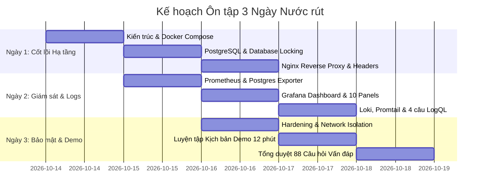

# 10. KẾ HOẠCH ÔN TẬP THI VẤN ĐÁP TRONG 3 NGÀY

---

## MỤC TIÊU VÀ NGUYÊN TẮC ÔN TẬP
- **Mục tiêu:** Giúp sinh viên làm chủ 100% kiến trúc dự án, tự tin giải thích từng dòng cấu hình, thuần thục thao tác demo trong 12 phút và phản xạ nhanh với các câu hỏi truy vấn sâu của giảng viên.
- **Nguyên tắc "3 Không":**
  1. *Không học vẹt định nghĩa:* Học theo mô hình **Hiểu đơn giản -> Bản chất kỹ thuật -> Áp dụng vào file nào trong dự án**.
  2. *Không nói chung chung:* Mọi câu trả lời đều phải gắn với tên service cụ thể (`booking-nginx`, `postgres`), cổng cụ thể (`8888`, `5432`), và file cụ thể.
  3. *Không che giấu sự thật:* Cấu hình nào có thì nhận và chứng minh; phần nào chưa có (như HTTPS) thì trình bày hiểu biết lý thuyết và hướng nâng cấp.

---

---

## NGÀY 1: NẮM VỮNG KIẾN TRÚC, DOCKER COMPOSE, POSTGRESQL VÀ NGINX

### Buổi Sáng (8h00 – 11h30): Kiến trúc Tổng quan và Docker Compose
- **Nhiệm vụ trọng tâm:**
  - Đọc kỹ tài liệu [01_Tong_quan_kien_truc.md](file:///c:/Users/ADMIN/Documents/booking-tour/docs/01_Tong_quan_kien_truc.md).
  - Mở file `docker-compose.yml`, dùng bút hoặc giấy vẽ lại sơ đồ 10 service, 4 network, và các port mapping.
  - Hiểu sâu sắc sự khác biệt giữa Port máy host (`8888`) và Port nội bộ container (`8080`).
  - Nắm vững cơ chế Docker DNS nội bộ: tại sao Backend gọi DB bằng `postgres` mà không dùng `localhost`.
- **Câu hỏi tự kiểm tra:**
  1. *Tại sao Nginx trong lệnh `docker compose ps` lại hiển thị `(unhealthy)`? Lỗi này bản chất là gì?*
     -> Trả lời: Do `wget http://localhost:8080/` trên Alpine phân giải IPv6 `[::1]`, trong khi `nginx.conf` chỉ listen IPv4. Nginx vẫn chạy bình thường với `127.0.0.1:8080`.
  2. *Chính sách `restart: unless-stopped` khác gì `restart: always`?*
  3. *Tại sao cần `depends_on: condition: service_healthy` với `pg_isready`?*

### Buổi Chiều (13h30 – 17h00): Cơ sở dữ liệu PostgreSQL và pgAdmin
- **Nhiệm vụ trọng tâm:**
  - Đọc kỹ tài liệu [02_Phan_tich_Docker_PostgreSQL_Nginx.md](file:///c:/Users/ADMIN/Documents/booking-tour/docs/02_Phan_tich_Docker_PostgreSQL_Nginx.md) (Phần 2 và 3).
  - Mở file `database/init.sql` và `backend/src/controllers/bookingController.js`.
  - Hiểu cách thức Transaction hoạt động: `BEGIN` -> `SELECT ... FOR UPDATE` -> `UPDATE available_seats` -> `INSERT bookings` -> `COMMIT`.
  - Mở pgAdmin (`http://localhost:5050`), thực hành kết nối vào database `booking_tour` với Host là `postgres`.
- **Câu hỏi tự kiểm tra:**
  1. *Làm thế nào để dữ liệu trong PostgreSQL không bị mất khi chạy `docker compose down`?*
  2. *Script `init.sql` chạy khi nào? Nếu chạy lại lần 2 có bị ghi đè không?*
  3. *Khóa dòng `FOR UPDATE` giải quyết bài toán gì trong nghiệp vụ đặt tour?*

### Buổi Tối (19h30 – 22h00): Nginx Reverse Proxy và Tiêu đề Bảo mật
- **Nhiệm vụ trọng tâm:**
  - Mở file `nginx/nginx.conf`. Đọc thuộc lòng vai trò của từng khối: `listen 8080`, `location /`, `location /api/`.
  - Mở terminal chạy lệnh: `curl.exe -I http://localhost:8888/` để nhìn tận mắt 6 tiêu đề bảo mật HTTP.
  - Hiểu rõ vì sao dự án chạy HTTP cổng 8888 mà chưa chạy HTTPS (chứng chỉ SSL).
- **Câu hỏi tự kiểm tra:**
  1. *Reverse Proxy giải quyết vấn đề gì cho Frontend? (CORS & Single Gateway).*
  2. *Chỉ thị `pid /tmp/nginx.pid;` có bắt buộc không? Vì sao? (Bắt buộc vì chạy non-root).*
  3. *Nếu gặp lỗi 502 Bad Gateway thì kiểm tra container nào trước?*

---

## NGÀY 2: CHUYÊN SÂU GIÁM SÁT PROMETHEUS, GRAFANA VÀ QUẢN TRỊ LOG LOKI

### Buổi Sáng (8h00 – 11h30): Hệ thống Giám sát Metrics với Prometheus
- **Nhiệm vụ trọng tâm:**
  - Đọc kỹ tài liệu [03_Prometheus_Grafana.md](file:///c:/Users/ADMIN/Documents/booking-tour/docs/03_Prometheus_Grafana.md).
  - Mở file `prometheus/prometheus.yml` và `backend/src/server.js`.
  - Hiểu cơ chế Kéo (Pull-based scrape) mỗi 15 giây.
  - Mở trình duyệt tại `http://localhost:9090/targets`, chứng minh 3 Target (`booking-backend`, `postgres`, `prometheus`) đều đang UP.
  - Phân biệt sự khác nhau giữa Container `Up` và Target Prometheus `UP`.
- **Câu hỏi tự kiểm tra:**
  1. *Prometheus lấy metrics từ Backend bằng cách nào? (Thư viện `prom-client` tại route `/metrics`).*
  2. *Tại sao PostgreSQL cần `postgres-exporter` mà Backend không cần?*
  3. *Hàm `rate()` trong PromQL dùng để làm gì?*

### Buổi Chiều (13h30 – 17h00): Grafana Dashboard và Trực quan hóa
- **Nhiệm vụ trọng tâm:**
  - Mở Grafana tại `http://localhost:3001` (admin / admin).
  - Mở Dashboard **"Booking Tour — Tổng quan hệ thống"**.
  - Học thuộc ý nghĩa của 10 Panel (Đặc biệt là Panel 1: HTTP req/s, Panel 3: Event loop lag, Panel 4: Transactions/s, và Panel 10: INSERT/s).
  - Thực hành: Mở 1 tab đặt tour trên web, quay lại Grafana quan sát cột sóng của Panel 10 (INSERT/s) và Panel 4 (Transactions/s) nhảy vọt lên.
- **Câu hỏi tự kiểm tra:**
  1. *Cơ chế Provisioning trong Grafana hoạt động thế nào? (Nạp tự động datasource và dashboard qua file YAML).*
  2. *Event loop lag của Node.js tăng cao biểu thị điều gì?*

### Buổi Tối (19h30 – 22h00): Quản trị Log Tập trung với Loki, Promtail và LogQL
- **Nhiệm vụ trọng tâm:**
  - Đọc kỹ tài liệu [04_Loki_Promtail_LogQL.md](file:///c:/Users/ADMIN/Documents/booking-tour/docs/04_Loki_Promtail_LogQL.md).
  - Mở file `promtail/promtail-config.yml` và `loki/loki-config.yml`.
  - Hiểu cách Promtail đọc log từ socket `/var/run/docker.sock:ro`, lọc container `/booking-.*` và gán nhãn `container_name`.
  - Mở Grafana Explore (`http://localhost:3001/explore`), chọn Loki và gõ thành thạo 2 câu lệnh LogQL:
    1. `{container_name="booking-nginx"}`
    2. `{container_name="booking-backend"} |= "error"`
- **Câu hỏi tự kiểm tra:**
  1. *Tại sao Loki lại nhẹ hơn Elasticsearch? (Chỉ đánh chỉ mục nhãn labels, không đánh chỉ mục toàn văn).*
  2. *LogQL khác PromQL ở điểm nào?*
  3. *Nếu Grafana không thấy log thì kiểm tra những gì?*

---

## NGÀY 3: BẢO MẬT HARDENING, LUYỆN TẬP DEMO VÀ TỔNG DUYỆT VẤN ĐÁP

### Buổi Sáng (8h00 – 11h30): Các Biện pháp Bảo mật và Hardening
- **Nhiệm vụ trọng tâm:**
  - Đọc kỹ tài liệu [05_Hardening_Bao_mat.md](file:///c:/Users/ADMIN/Documents/booking-tour/docs/05_Hardening_Bao_mat.md).
  - Thuộc lòng 7 biện pháp bảo mật đã triển khai trong dự án.
  - Mở terminal chạy các lệnh chứng minh bảo mật:
    - `docker exec booking-backend id` -> UID 1000.
    - `docker exec booking-nginx id` -> UID 101.
    - `docker exec booking-nginx ping -c 1 postgres` -> Báo lỗi `bad address` (Chứng minh cô lập mạng).
- **Câu hỏi tự kiểm tra:**
  1. *Tại sao chạy container root lại nguy hiểm? (Nguy cơ Container Escape chiếm máy host).*
  2. *Tại sao mount `docker.sock` bắt buộc phải có cờ `:ro`?*
  3. *Rate Limiting trong Backend được cấu hình ở những route nào?*

### Buổi Chiều (13h30 – 17h00): Luyện tập Kịch bản Demo Thực tế (10 – 15 Phút)
- **Nhiệm vụ trọng tâm:**
  - Mở tài liệu [07_Kich_ban_Demo.md](file:///c:/Users/ADMIN/Documents/booking-tour/docs/07_Kich_ban_Demo.md).
  - Đặt đồng hồ bấm giờ (Timer: 12 phút).
  - Tự mình thực hiện toàn bộ 9 bước demo từ đầu đến cuối:
    1. Git log (Terminal).
    2. Docker Compose ps (Terminal).
    3. Mở web cổng 8888 và đặt 1 tour mới.
    4. Mở pgAdmin cổng 5050 chứng minh đơn đã lưu và ghế đã trừ.
    5. F12 Network xem Server nginx và Security headers.
    6. Mở Prometheus cổng 9090 xem 3 target UP.
    7. Mở Grafana cổng 3001 xem Dashboard 10 panels.
    8. Mở Explore chạy LogQL Nginx và Backend.
    9. Chạy lệnh chứng minh Non-root và Network isolation.
  - Lặp lại kịch bản ít nhất **3 lần** cho đến khi không còn vấp thao tác nào.

### Buổi Tối (19h30 – 22h30): Tổng duyệt Bộ 88 Câu hỏi Vấn đáp
- **Nhiệm vụ trọng tâm:**
  - Mở tài liệu [06_80_Cau_hoi_Van_dap.md](file:///c:/Users/ADMIN/Documents/booking-tour/docs/06_80_Cau_hoi_Van_dap.md).
  - Đọc lướt qua cả 10 nhóm câu hỏi.
  - Tập trung đặc biệt vào các câu hỏi phản biện ở Nhóm 9 (Xử lý sự cố) và Nhóm 10 (Mở rộng hệ thống, Scale ngang, Caching Redis, Kubernetes).
  - Chuẩn bị tâm thế tự tin, phong thái đàng hoàng và ngủ đủ giấc trước ngày thi.

---

## BẢNG DANH MỤC TÀI LIỆU CẦN ĐỌC THEO THỨ TỰ ƯU TIÊN

| Thứ tự | Tên File Tài liệu | Mục đích cốt lõi | Thời gian đọc gợi ý |
|:---:|---|---|:---:|
| **1** | [07_Kich_ban_Demo.md](file:///c:/Users/ADMIN/Documents/booking-tour/docs/07_Kich_ban_Demo.md) | Nắm chắc các bước trình diễn và lời thoại trước hội đồng | 30 phút |
| **2** | [01_Tong_quan_kien_truc.md](file:///c:/Users/ADMIN/Documents/booking-tour/docs/01_Tong_quan_kien_truc.md) | Nắm toàn bộ bức tranh kiến trúc và bảng 10 container | 45 phút |
| **3** | [02_Phan_tich_Docker_PostgreSQL_Nginx.md](file:///c:/Users/ADMIN/Documents/booking-tour/docs/02_Phan_tich_Docker_PostgreSQL_Nginx.md) | Hiểu bản chất Docker Compose, Database và Reverse Proxy | 60 phút |
| **4** | [03_Prometheus_Grafana.md](file:///c:/Users/ADMIN/Documents/booking-tour/docs/03_Prometheus_Grafana.md) | Làm chủ PromQL và giải thích 10 panel Dashboard | 45 phút |
| **5** | [04_Loki_Promtail_LogQL.md](file:///c:/Users/ADMIN/Documents/booking-tour/docs/04_Loki_Promtail_LogQL.md) | Nắm cơ chế thu thập log Docker Socket và LogQL | 45 phút |
| **6** | [05_Hardening_Bao_mat.md](file:///c:/Users/ADMIN/Documents/booking-tour/docs/05_Hardening_Bao_mat.md) | Thuộc lòng 7 biện pháp bảo mật thực tế | 30 phút |
| **7** | [06_80_Cau_hoi_Van_dap.md](file:///c:/Users/ADMIN/Documents/booking-tour/docs/06_80_Cau_hoi_Van_dap.md) | Ôn luyện toàn diện câu hỏi giảng viên và câu hỏi truy vấn sâu | 90 phút |
| **8** | [08_Doi_chieu_Rubric.md](file:///c:/Users/ADMIN/Documents/booking-tour/docs/08_Doi_chieu_Rubric.md) | Nắm chắc các bằng chứng tương ứng với barem chấm thi | 20 phút |
| **9** | [09_Cheatsheet_Lenh.md](file:///c:/Users/ADMIN/Documents/booking-tour/docs/09_Cheatsheet_Lenh.md) | Cứu cánh tra cứu nhanh lệnh PowerShell khi bị quên | 20 phút |
